# Attack vectors against USDT payments: a field guide

> Generated from the data behind the website's **Attack vectors** section (`src/ui/vectors.ts`, `src/ui/scenes*.ts`, `src/ui/incidents.ts`), the [threat matrix](THREAT_MATRIX.md) and the [local-chain proof](PROOF.md). Do not edit by hand: run `WRITE_DOCS=1 npx vitest run tests/research.test.ts`.

## Abstract

"Flash USDT" is a social-engineering scam, not a technology: a payment is made to *look* like real USDT when it is not, or a real payment is shown out of context. This document catalogues **51 attack vectors** used against people who receive or send USDT on BNB Smart Chain, Ethereum and Tron, from fake tokens and forged events to address poisoning, approval phishing, EIP-7702 delegation drainers and lying infrastructure. For each vector it gives the mechanism, what the victim sees, a flow diagram of who does what and which funds move where, the detection rule implemented in this project, the tests that prove that rule, a reproduction on a local chain where one exists, and a documented real-world case with its source.

Of the 51 vectors, **42 are detected** by on-chain rules in this tool and **9 are residual** (off-chain or device-level: they are documented, and the UI warns about them, but the chain alone cannot prove them). **27** vectors are reproduced end to end with real transactions on a local Anvil chain.

## Method

- **Threat model.** The attacker controls any number of addresses and contracts on the target chain, can pay gas, can message the victim, and may control a website, an RPC endpoint or the victim's clipboard. The attacker cannot forge signatures of addresses they do not control and cannot change the canonical USDT contracts.
- **Identity rule.** Real USDT is exactly one contract per chain (registry in `src/registry/usdt.ts`). Name, symbol, logo, decimals and price are never used for identity.
- **Evidence.** Rules are pure functions over normalized chain data (`src/verdict/`), unit-tested in `tests/`. Behavioural vectors are reproduced with purpose-built malicious contracts on a local chain (`contracts/src/`, `e2e/scenarios.ts`); those contracts refuse to deploy anywhere except a local chain or BSC testnet.
- **Field data.** Real mainnet examples are in [TEST_TXS.md](TEST_TXS.md). Each vector below cites one published real-world case; summaries only state what the linked source reports.
- **Defense layers.** L0 input, L1 consensus and finality, L2 token identity, L3 net amounts, L4 context (recipient, amount, time, reuse), L5 lookalikes and history, L6 token behaviour, L7 account control, L8 app and infrastructure. See the README's [Defense layers](../README.md#defense-layers).

## Taxonomy

| Group | Vectors | Critical | High | Medium | Low |
|---|---|---|---|---|---|
| Token identity | 8 | 1 | 6 | 1 | 0 |
| Flash-USDT behaviours | 6 | 2 | 1 | 3 | 0 |
| Transaction deception | 11 | 3 | 4 | 3 | 1 |
| Address poisoning | 5 | 2 | 2 | 1 | 0 |
| Approvals and account control | 6 | 3 | 2 | 1 | 0 |
| Off-chain and infrastructure | 12 | 1 | 8 | 3 | 0 |
| Other chains | 3 | 0 | 1 | 2 | 0 |
| **Total** | **51** | **12** | **24** | **14** | **1** |

## All vectors at a glance

| ID | Vector | Chains | Severity | Layer(s) | Status | Real-world case |
|---|---|---|---|---|---|---|
| [A1](#a1-fake-tether-usd-token) | Fake "Tether USD" token | All EVM, Tron | Critical | L2 | Detected, reproduced | [Fake USDT that looked like it came from an exchange](https://support.token.im/hc/en-us/articles/59274708455193-Beware-of-Fake-USDT-An-Exchange-Hot-Wallet-Label-Is-Not-an-Endorsement-Security-Monthly-Report-49th-Issue) |
| [A2](#a2-homoglyph--invisible-name) | Homoglyph / invisible name | All | High | L0, L2, L6 | Detected, reproduced | [Lookalike Unicode characters used to impersonate names](https://support.ens.domains/faq/normalization/homoglyphs) |
| [A3](#a3-fake-1-price) | Fake $1 price | EVM (DEX) | High | L2 | Detected | [Pool manipulation pushed a token price up 22,000%](https://research.checkpoint.com/2023/crypto-deception-unveiled-check-point-research-reports-manipulation-of-pool-liquidity-skyrockets-token-price-by-22000/) |
| [A4](#a4-bridged--pegged--dead-bridge-copy) | Bridged / pegged / dead-bridge copy | BSC, ETH, L2s | High | L2 | Detected, reproduced | [Multichain collapse](https://www.chainalysis.com/blog/multichain-exploit-july-2023/) |
| [A5](#a5-chain-confusion) | Chain confusion | All | High | L0, L1, L2 | Detected, reproduced | [Paid in testnet ETH that is worth nothing](https://support.metamask.io/stay-safe/protect-yourself/tokens-and-transactions/testnet-eth-scams/) |
| [A6](#a6-decimals-confusion) | Decimals confusion | BSC vs ETH/Tron | High | L2, L3 | Detected, reproduced | [Custom-decimals fake balances](https://support.trustwallet.com/en/articles/717671-custom-decimal-scams-how-fake-token-balances-are-used-to-steal-funds) |
| [A7](#a7-token-name-carries-a-lure) | Token name carries a lure | All | High | L6, L8 | Detected, reproduced | [Etherscan masks unknown token names](https://kb.etherscan.com/what-is-masked-token-name-and-symbol) |
| [A36](#a36-tampered-address-in-the-request) | Tampered address in the request | All | Medium | L0 | Detected | [More than 12,000 ETH lost to one-character typos](https://www.fourmilab.ch/scanalyzer/archives/2021/10/fat-fingermore-than-12000-ethereum-lost-in-typos.html) |
| [B8](#b8-expiring--revocable-balance) | Expiring / revocable balance | EVM, Tron | Critical | L2, L6 | Detected, reproduced | [The flash USDT scam explained](https://www.globalantiscam.org/post/unmasking-the-flash-usdt-scam-how-it-works-and-how-to-stay-safe) |
| [B9](#b9-honeypot) | Honeypot | EVM, Tron | High | L2, L6 | Detected, reproduced | [Honeypot tokens: easy to buy, impossible to sell](https://tokin.dedaub.com/learn/honeypot) |
| [B10](#b10-upgradeable-proxy) | Upgradeable proxy | EVM | Medium | L2, L6 | Detected, reproduced | [OpenZeppelin UUPS upgrade vulnerability](https://forum.openzeppelin.com/t/uupsupgradeable-vulnerability-post-mortem/15680) |
| [B11](#b11-lying-balanceof--events-with-no-balance) | Lying balanceOf / events with no balance | EVM, Tron | Critical | L2, L6 | Detected, reproduced | [Faked USDT balances reported by SlowMist](https://news.bitcoin.com/scammers-trick-crypto-users-with-faked-usdt-balances-slowmist-reports/) |
| [B12](#b12-fee-on-transfer--rebasing) | Fee-on-transfer / rebasing | EVM | Medium | L3, L6 | Detected, reproduced | [Balancer pools drained through deflationary tokens](https://slowmist.medium.com/detailed-analysis-of-balancer-hack-de8bd86020de) |
| [B49](#b49-token-that-self-destructs-or-changes-code) | Token that self-destructs or changes code | EVM | Medium | L6 | Detected | [Tornado Cash governance takeover](https://rekt.news/tornado-gov-rekt) |
| [C13](#c13-forged-transfer-events) | Forged Transfer events | EVM, Tron | Critical | L2, L3 | Detected, reproduced | [Spoofed token transfers right after the Monad launch](https://decrypt.co/350053/monad-hit-spoofed-token-transfers-days-after-mainnet-launch) |
| [C14](#c14-mixed-tx) | Mixed tx | EVM, Tron | Critical | L3, L4 | Detected, reproduced | [False top-up attacks on exchanges](https://slowmist.medium.com/how-does-the-false-top-up-attack-break-through-the-defense-of-the-exchange-d6e8ebb434f5) |
| [C15](#c15-reverted-tx-as-proof) | Reverted tx as proof | All | High | L1 | Detected, reproduced | [Fake transaction records used as proof](https://support.token.im/hc/en-us/articles/17009391596697-Be-wary-of-the-fake-transaction-record-scam) |
| [C16](#c16-pending--replaced-tx) | Pending / replaced tx | EVM | High | L1 | Detected, reproduced | [Zero-confirmation payments can be replaced](https://www.spark.money/research/zero-conf-bitcoin-explained) |
| [C17](#c17-not-final--reorg) | Not final / reorg | All | Medium | L1 | Detected, reproduced | [Seven-block reorg on the Ethereum beacon chain](https://barnabe.substack.com/p/pos-ethereum-reorg) |
| [C18](#c18-real-tx-wrong-context) | Real tx, wrong context | All | Critical | L4 | Detected, reproduced | [The P2P triangle scam](https://www.binance.com/en/square/post/610733) |
| [C19](#c19-in-and-out-in-the-same-tx) | In and out in the same tx | EVM | High | L3 | Detected, reproduced | [Fake deposit bug in THORChain](https://slowmist.medium.com/analysis-of-the-fake-deposit-vulnerability-in-thorchains-cross-chain-system-dacabcb932da) |
| [C20](#c20-malformed--wrong-object-hash) | Malformed / wrong-object hash | All | Medium | L0 | Detected, reproduced | [Tokens sent to the wrong object are lost](https://github.com/ethereum/EIPs/issues/223) |
| [C37](#c37-payment-via-router--multicall) | Payment via router / multicall | EVM | Low | L3 | Detected, reproduced | [Deposits through contracts are missed by some systems](https://info.etherscan.com/transaction-marked-success-but-i-cant-see-my-funds-why) |
| [C38](#c38-native-coin--trc10-usdt) | Native coin / TRC10 "USDT" | Tron, EVM | High | L2 | Detected | [TRC10 tokens on Tronscan flagged unsafe](https://forum.trondao.org/t/trc-10-on-tronscan-got-unsafe-status/22939) |
| [C40](#c40-split-view--minority-fork) | Split view / minority fork | All | Medium | L1 | Detected | [Ethereum Classic 51% attack](https://securityaffairs.com/79628/hacking/ethereum-classic-51-attack.html) |
| [D21](#d21-zero-value-transferfrom-from-the-victim) | Zero-value transferFrom from the victim | EVM, Tron | High | L5, L7 | Detected, reproduced | [How address poisoning works, in depth](https://www.blockaid.io/blog/a-deep-dive-into-address-poisoning) |
| [D22](#d22-vanity-dust) | Vanity dust | EVM, Tron | Critical | L3, L5 | Detected, reproduced | [Vanity lookalike addresses](https://kb.etherscan.com/what-is-address-poisoning) |
| [D23](#d23-poisoned-address-copied-at-withdrawal) | Poisoned address copied at withdrawal | All | Critical | L5 | Detected | [$68 million of WBTC sent to a poisoned address](https://www.halborn.com/blog/post/massive-68-million-address-poisoning-hack-underscores-ongoing-cyber-threat) |
| [D41](#d41-weak-lookalike-prefix-only) | Weak lookalike (prefix only) | All | Medium | Residual | Residual | [Carnegie Mellon study of address poisoning](https://arxiv.org/abs/2501.16681) |
| [D42](#d42-poisoning-with-fake-tokens) | Poisoning with fake tokens | EVM, Tron | High | L5, L6 | Detected, reproduced | [DEA lost about $55,000 of USDT to a fake-token poisoning](https://bitcoinist.com/crypto-scammers-outwit-dea/amp/) |
| [E24](#e24-approval--permit-phishing) | Approval / permit phishing | EVM, Tron | Critical | L7 | Detected, reproduced | [PEPE holder loses $1.39M to a Permit2 signature](https://decrypt.co/286076/pepe-uniswap-permit2-phishing-attack) |
| [E25](#e25-eip-7702-delegation-phishing) | EIP-7702 delegation phishing | ETH, BSC | Critical | L7 | Detected, reproduced | [Wintermute on EIP-7702 delegation abuse](https://www.theblock.co/news/ecosystems/2025-06-01-wintermute-warns-pectra-upgrade-leaves-ethereum-users-at-risk-of-automated-attacks-356481) |
| [E26](#e26-leaked-seed-free-wallet-with-usdt-bait) | Leaked-seed "free wallet with USDT" bait | Tron, EVM | High | L7, residual | Residual | [Honeypot wallets with a sweeper script](https://support.metamask.io/stay-safe/protect-yourself/social-engineering/honeypot-scams) |
| [E27](#e27-tron-energy-scams--multi-sig-hijack) | Tron energy scams / multi-sig hijack | Tron | High | L7 | Detected | [Over 14,500 Tron addresses at risk of silent hijacking](https://cointelegraph.com/news/tron-addresses-risk-silent-hijacking) |
| [E43](#e43-clipboard-hijacker) | Clipboard hijacker | All | Critical | L5, residual | Residual | [Clipper malware in a fake Tor Browser](https://www.kaspersky.com/about/press-releases/2023_new-clipper-malware-steals-us400000-in-cryptocurrencies-via-fake-tor-browser) |
| [E44](#e44-approvals-on-other-tokens--nfts) | Approvals on other tokens / NFTs | EVM | Medium | Residual | Residual | [OpenSea phishing: NFTs taken through existing approvals](https://halborn.com/explained-the-opensea-phishing-hack-february-2022/) |
| [F28](#f28-edited-screenshots-fake-receipts-fake-binance-messages) | Edited screenshots, fake receipts, fake "Binance" messages | — | Critical | L1, residual | Residual | [Fake bank-transfer screenshots in P2P trades](https://onekey.so/blog/ecosystem/how-to-detect-and-avoid-c2c-crypto-scams-and-frauds) |
| [F29](#f29-fake-explorer-site) | Fake explorer site | All | High | L0, L8 | Detected | [Cloned Blockworks and Etherscan sites spread a fake exploit alert](https://cointelegraph.com/news/fake-uniswap-37m-approval-exploit-phishing-scam-blockworks) |
| [F30](#f30-lying--hijacked-rpc) | Lying / hijacked RPC | All | High | L1 | Detected, reproduced | [Malicious RPC node links used to steal assets](https://slowmist.medium.com/unveiling-a-new-scam-malicious-modification-of-rpc-node-links-to-steal-assets-2ca324200853) |
| [F31](#f31-dirty-real-usdt) | "Dirty" real USDT | ETH, Tron | High | L5 | Detected | [Tether, Tron and TRM froze $100 million of USDT](https://cointelegraph.com/news/tether-tron-trm-labs-froze-100-million-usdt-2024) |
| [F32a](#f32a-xss-via-token-names) | XSS via token names | — | High | L8 | Detected | [Token symbol used as a script in Sablier NFTs](https://hackenproof.com/blog/web2-bugs-web3-smart-contract-security) |
| [F32b](#f32b-leaked-api-keys) | Leaked API keys | — | Medium | L8 | Detected | [Vercel breach sends crypto developers rotating API keys](https://coindesk.com/tech/2026/04/20/hack-at-vercel-sends-crypto-developers-scrambling-to-lock-down-api-keys) |
| [F32c](#f32c-cache-poisoning-of-verdicts) | Cache poisoning of verdicts | — | Medium | L8 | Detected | [Practical Web Cache Poisoning](https://portswigger.net/research/practical-web-cache-poisoning) |
| [F32d](#f32d-phishing-clones-of-this-site) | Phishing clones of this site | — | High | L8, residual | Residual | [Inferno Drainer used 16,000 domains to spoof 100+ brands](https://siliconangle.com/2024/01/16/group-ib-uncovers-16000-malicious-domains-used-inferno-drainer-crypto-scam/) |
| [F32e](#f32e-dependency-supply-chain) | Dependency supply chain | — | High | L8 | Detected | [Ledger Connect Kit supply-chain attack](https://slowmist.medium.com/supply-chain-attack-on-ledger-connect-kit-analyzing-the-impact-and-preventive-measures-1005e39422fd) |
| [F45](#f45-screenshot-of-this-tool-saying-verified) | Screenshot of *this tool* saying VERIFIED | — | High | Residual | Residual | [A wallet screen that looked paid, in Venezuelan shops](https://news.bitcoin.com/scammers-use-fake-usdt-tokens-to-steal-from-venezuelan-merchants/) |
| [F46](#f46-time-pressure--social-engineering) | Time pressure / social engineering | — | High | Residual | Residual | [FTC warning on urgency and pressure scams](https://cointelegraph.com/news/ftc-issues-public-warning-about-new-crypto-atm-scam) |
| [F47](#f47-network-mitm--dns-hijack) | Network MITM / DNS hijack | — | Medium | L1, L8 | Detected | [Celer cBridge BGP hijack](https://www.coinbase.com/blog/celer-bridge-incident-analysis) |
| [G33](#g33-solana-tricks-not-supported-yet) | Solana tricks (not supported yet) | Solana | Medium | Residual (future) | Residual | [Solana Permanent Delegate token burns holder balances](https://cointelegraph.com/news/new-solana-scam-burn-tokens-from-inside-sol-wallets) |
| [G34](#g34-tron-fake-trc20-usdt) | Tron: fake TRC20 USDT | Tron | High | L1, L2, L7 | Detected | [Tron multisig permission scam](https://support.token.im/hc/en-us/articles/45178389417241-TRX-Remove-Multisig-Restriction-Scam-Security-Monthly-Report-36th-Issue) |
| [G35](#g35-any-new-chain) | Any new chain | — | Medium | Registry | Detected | [Wormhole: a Solana-specific signature check was missing](https://www.halborn.com/blog/post/explained-the-wormhole-hack-february-2022) |

## Token identity

### A1 Fake "Tether USD" token

**Severity:** Critical · **Chains:** All EVM, Tron · **Layer(s):** L2

**Mechanism.** Deploys an ERC20/TRC20 named "Tether USD", symbol "USDT", and transfers it to the victim.

**What the victim sees.** Wallet shows "+5,000 USDT", sometimes with the Tether logo.

**Attack flow.**

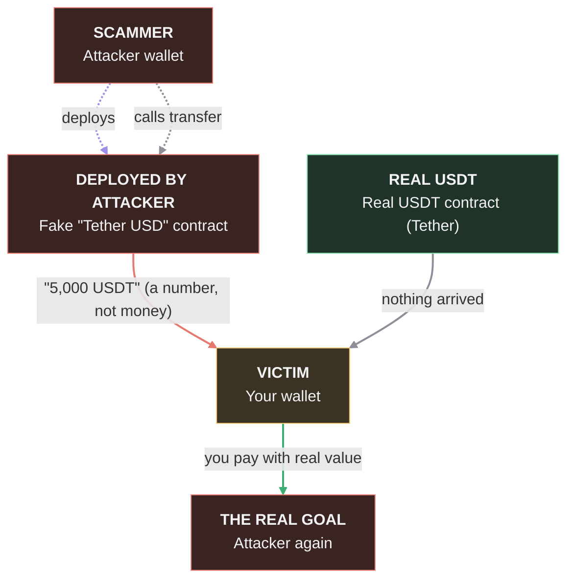

*Why wallets fall for it: the name and symbol are data the contract itself reports, so anyone can choose them.*

**Step by step.**

1. The attacker deploys their own ERC-20 contract. They pick the name "Tether USD" and the symbol USDT. It costs only gas, and the attacker needs no real USDT.
2. The attacker calls the contract so its own storage says your address holds 5,000, and it emits a Transfer event. Those numbers exist only inside the attacker's contract.
3. Your wallet and the block explorer read the name and symbol from that contract, so they show "+5,000 USDT". Nothing was taken from the real Tether contract.
4. The attacker now pressures you: release the goods, ship the order, or send a "fee" to unlock the funds. The real money flows from you to them.
5. This tool: only the official contract address counts as USDT. This contract is not that address, so the result is FAKE USDT.

**Detection.** Only chain + contract in the registry counts. Any other emitter is a decoy.

**Rule (L2, L6).** `L2.identity`: a log counts as USDT only if `log.address == USDT[chain].hex`. No canonical log → fail → FAKE. L6 `impersonates-usdt` explains it

**Tests.** `verifyTx`: "A1 fake token named Tether USD: no canonical log -> FAKE"; `tokenRisk`: "A1 named Tether USD / USDT -> impersonates-usdt"; `wallet`: "A1 fake USDT received is separated from real USDT totals"

**Reproduced on a local chain.**

- `A1-fake-tether`: Fake token named "Tether USD"/"USDT" sent A to B → FAKE; L2.identity fail; L6: impersonates-usdt, mint

**Real-world case.** *Fake USDT that looked like it came from an exchange.* A wallet-security report warns that a fake USDT token can arrive looking like a transfer from an exchange hot wallet, and that an exchange label is not an endorsement of the token. Source: [imToken security report](https://support.token.im/hc/en-us/articles/59274708455193-Beware-of-Fake-USDT-An-Exchange-Hot-Wallet-Label-Is-Not-an-Endorsement-Security-Monthly-Report-49th-Issue).

### A2 Homoglyph / invisible name

**Severity:** High · **Chains:** All · **Layer(s):** L0, L2, L6

**Mechanism.** Name or symbol uses Cyrillic Ѕ/Т, zero-width chars, RTL override, USD₮, USDT.e, USDT0, trailing spaces.

**What the victim sees.** Looks exactly like USDT, or sorts next to it.

**Attack flow.**

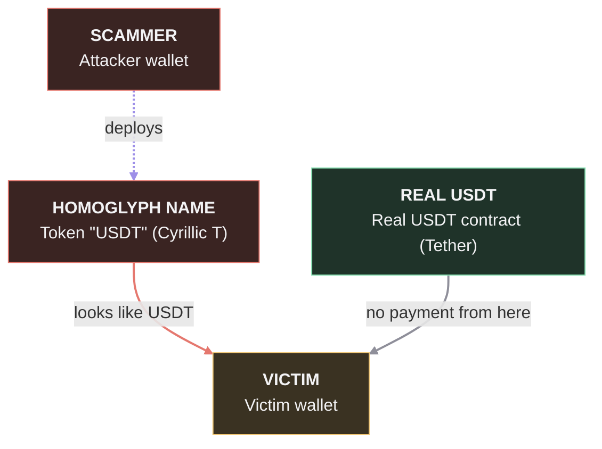

*Fix: compare contract addresses, never names.*

**Step by step.**

1. The attacker deploys a token whose name looks like USDT but uses a different letter (Cyrillic Т or Ѕ), a zero-width space, USD₮, or a trailing space.
2. It is sent to you or a victim. In a list of tokens it sits next to or looks identical to the real one.
3. A person checking by eye, or a script comparing the symbol string, is fooled.
4. This tool ignores names completely. L2 only accepts the exact official address, and L6 reports invisible or non-ASCII characters in the name.

**Detection.** Identity ignores names (L2). L6 maps names to an ASCII skeleton and reports non-ASCII, invisible and bidi characters. L0 rejects non-ASCII in hashes/addresses.

**Rule (L0, L2, L6).** L0 rejects non-ASCII in hashes and addresses. L2 ignores names. L6 `analyzeName` reports `non-ascii`, `invisible`, `bidi` and maps the name to a skeleton for `usdt-lookalike`

**Tests.** `input`: "A2 rejects homoglyph characters inside a hash", "A2 rejects Cyrillic lookalike letters in a Tron address"; `tokenRisk`: "Cyrillic letters map to the ASCII skeleton USDT", "USD₮, zero-width and RTL tricks are reported", "USDT.e / USDT0 / trailing spaces still read as USDT lookalikes"

**Reproduced on a local chain.**

- `A2-homoglyph`: Symbol uses Cyrillic letters (looks like USDT) → FAKE; L2.identity fail; L6: impersonates-usdt, mint
- `A2-tugrik`: Symbol "USD₮" → FAKE; L2.identity fail; L6: impersonates-usdt, mint

**Real-world case.** *Lookalike Unicode characters used to impersonate names.* ENS documents scammers using characters that look identical but are different Unicode code points, including invisible zero-width characters, to impersonate valuable names. Source: [ENS support](https://support.ens.domains/faq/normalization/homoglyphs).

### A3 Fake $1 price

**Severity:** High · **Chains:** EVM (DEX) · **Layer(s):** L2

**Mechanism.** Seeds a tiny PancakeSwap/Uniswap pool of fake-USDT/USDT or fake-USDT/BNB, so price feeds show ~$1.

**What the victim sees.** Wallet shows a dollar value next to the balance.

**Attack flow.**

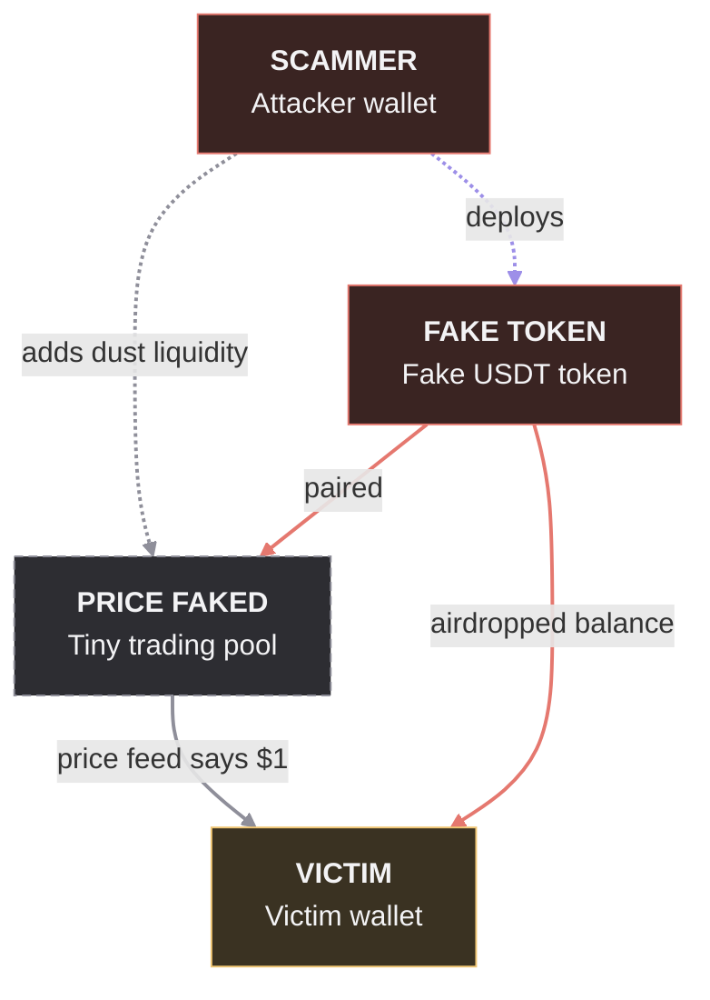

**Step by step.**

1. The attacker deploys a fake token and creates a small trading pool pairing it with a real asset.
2. By adding a tiny amount on the real side and trading with themselves, they set a price near $1.
3. A wallet or tracker reads the pool price and shows "$5,000" beside the balance, which makes the fake token look valuable and real.
4. The pool holds almost nothing, so there is nothing real to sell into. Price is not proof of identity.
5. This tool never uses price in a verdict. Identity is the contract address only.

**Detection.** Price is never an input to the verdict. Identity is the contract address only.

**Rule (L2).** Price is not an input to any rule. Identity = contract address

**Tests.** `verifyTx`: "A3 fake token with a self-funded $1 pool: price never enters the verdict"

**Real-world case.** *Pool manipulation pushed a token price up 22,000% (2023).* Check Point Research reported a scammer who distorted a liquidity pool so a token price jumped about 22,000%, and took roughly $80,000 from holders. Source: [Check Point Research](https://research.checkpoint.com/2023/crypto-deception-unveiled-check-point-research-reports-manipulation-of-pool-liquidity-skyrockets-token-price-by-22000/).

### A4 Bridged / pegged / dead-bridge copy

**Severity:** High · **Chains:** BSC, ETH, L2s · **Layer(s):** L2

**Mechanism.** Pays with a token that once had value (e.g. Multichain-era bridged USDT) or a different "USDT" peg on the same chain.

**What the victim sees.** A token called USDT, maybe with real history.

**Attack flow.**

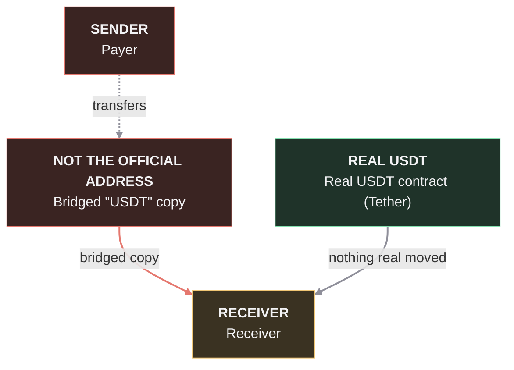

**Step by step.**

1. A token once had real value somewhere, for example a bridged copy of USDT, and its bridge later broke or was shut down.
2. The token keeps its name, logo and history, so it looks legitimate.
3. The attacker pays with it, or sells it as "USDT", and the victim sees a real-looking asset.
4. This tool checks the official address for the chosen chain. A bridged or pegged copy is a different contract, so it is a decoy.

**Detection.** Not in the registry for this chain, so it is a decoy.

**Rule (L2).** Same as A1: any non-registry contract is a decoy

**Tests.** `verifyTx`: "A4 bridged/pegged lookalike contract on the same chain -> FAKE (identity is address only)"

**Reproduced on a local chain.**

- `A4-bridged`: Lookalike "USDT.e" token on the same chain → FAKE; L2.identity fail; L6: impersonates-usdt, mint

**Real-world case.** *Multichain collapse (July 2023).* Chainalysis described unusually large unauthorized withdrawals from Multichain, more than $125 million, leaving the bridge and the tokens it issued on other chains in doubt. Source: [Chainalysis](https://www.chainalysis.com/blog/multichain-exploit-july-2023/).

### A5 Chain confusion

**Severity:** High · **Chains:** All · **Layer(s):** L0, L1, L2

**Mechanism.** Sends on another chain, on a testnet (BSC testnet chainId 97) or a fork, then shares that hash.

**What the victim sees.** Explorer page of a "successful USDT transfer".

**Attack flow.**

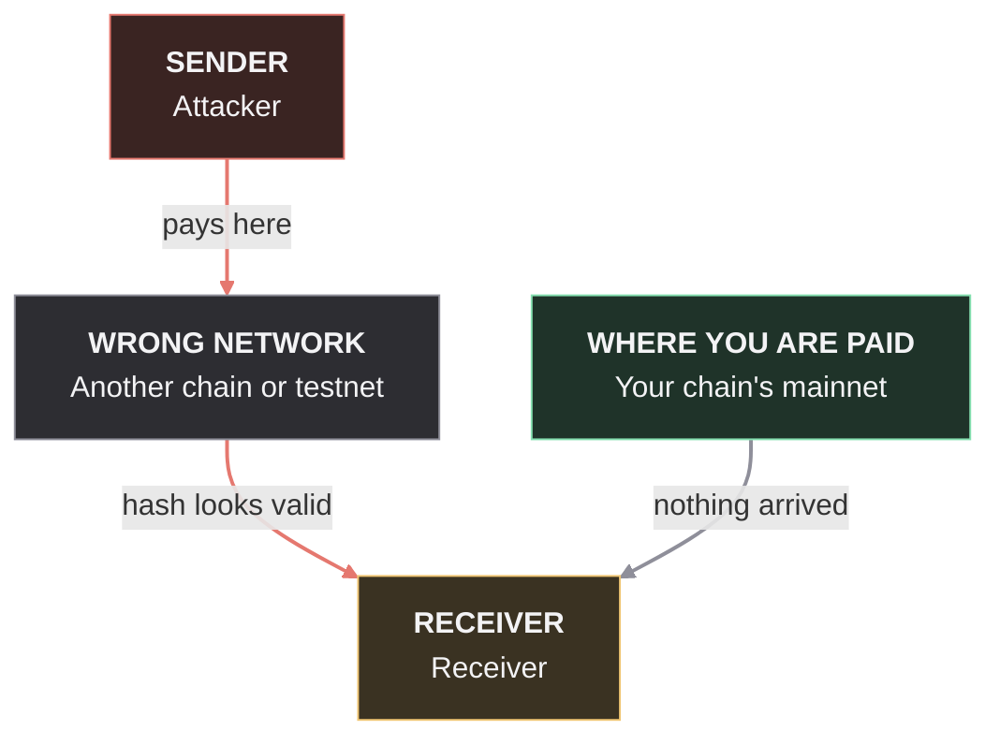

**Step by step.**

1. The attacker pays on a different network, such as a testnet, a fork, or another EVM chain, and shares the transaction hash.
2. The same hash format exists on every EVM chain, so opening it on the wrong explorer shows a "successful USDT transfer".
3. You believe the money arrived. On the real chain you use, the hash does not exist.
4. This tool makes you choose the chain and only reads that chain's mainnet nodes. If the hash is not there, the result is NOT RECEIVED.

**Detection.** The user chooses the chain. Ambiguous formats are refused (0x vs Tron). The hash must exist on that chain's mainnet RPCs, otherwise NOT RECEIVED. Explorer links come from the registry.

**Rule (L0, L1, L2).** L0 refuses a 0x hash on Tron and a bare 64-hex hash on EVM. L1: unknown on this chain's mainnet RPCs → NOT RECEIVED. L2 uses the per-chain registry entry

**Tests.** `input`: "A5 refuses ambiguous chain: Tron-style hash on BSC, 0x hash on Tron"; `verifyTx`: "A5 chain confusion: tx unknown on the chosen chain -> NOT RECEIVED", "A5 Ethereum USDT address appearing on BSC is not BSC USDT"

**Reproduced on a local chain.**

- `A5-chain-confusion`: The local tx hash checked against real BSC mainnet → NOT RECEIVED: a tx on another chain proves nothing on BSC

**Real-world case.** *Paid in testnet ETH that is worth nothing.* MetaMask warns of buyers who pay for goods or NFTs with testnet ETH, which anyone can get free from a faucet, and make it look valuable, for example by showing a fiat value on a test network. Once the seller hands over the asset, it cannot be reversed. Source: [MetaMask support](https://support.metamask.io/stay-safe/protect-yourself/tokens-and-transactions/testnet-eth-scams/).

### A6 Decimals confusion

**Severity:** High · **Chains:** BSC vs ETH/Tron · **Layer(s):** L2, L3

**Mechanism.** Relies on BSC USDT having 18 decimals while ETH/Tron have 6. A raw value of 5000000000 is 5,000 USDT on Tron but 0.000000005 USDT on BSC.

**What the victim sees.** "5000000000" in a raw explorer view or a script.

**Attack flow.**

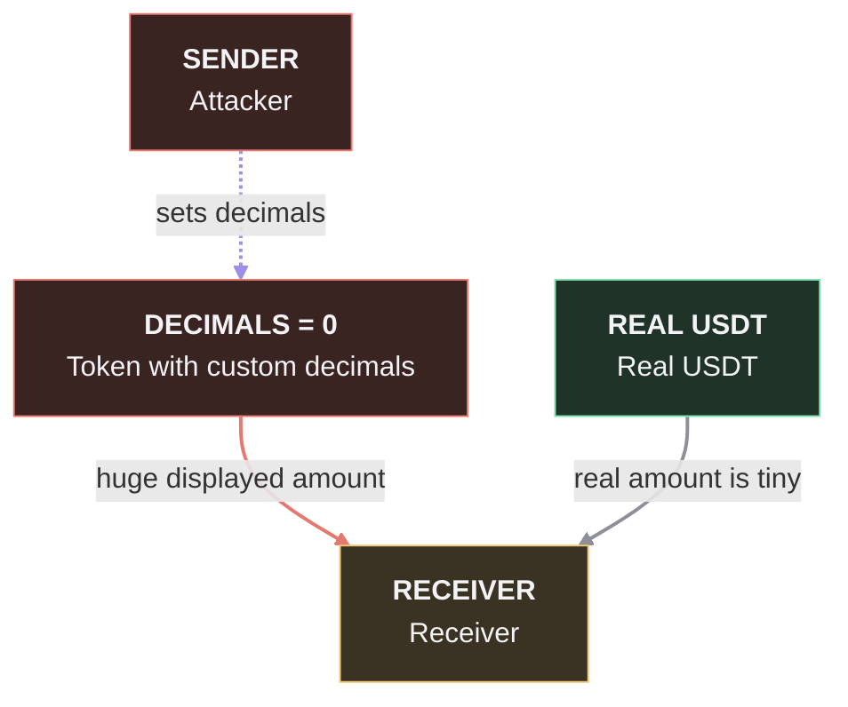

**Step by step.**

1. USDT on BSC has 18 decimals. On Ethereum and Tron it has 6. The same raw number means very different amounts.
2. The attacker shows a raw value such as 5000000000. On Tron it is 5,000 USDT. On BSC it is 0.000000005 USDT.
3. Or a fake token sets its own decimals, for example 0, so a small raw number is displayed as a huge one.
4. This tool uses the decimals stored in its registry for each chain, never the token's own claim.

**Detection.** Registry decimals only, per chain.

**Rule (L2, L3).** `formatUnits(value, USDT[chain].decimals)`. The token's own `decimals()` is never used. Net < 1 USDT → `L3.net` warn

**Tests.** `verifyTx`: "A6 decimals: BSC uses 18, Ethereum and Tron use 6"; `input`: "parses decimals exactly"; `registry`: "decimals: BSC 18, Ethereum 6, Tron 6"

**Reproduced on a local chain.**

- `A6-six-decimals`: Fake USDT with 6 decimals, 5,000 units → FAKE; L2.identity fail; L6: impersonates-usdt, mint
- `A6-canonical-raw`: Canonical USDT, raw value 5,000,000,000 on an 18-decimal chain is dust → UNVERIFIED; net 0.000000005 (dust), not 5,000

**Real-world case.** *Custom-decimals fake balances.* Trust Wallet explains a scam where a worthless token with 0 decimals is airdropped so the wallet shows a huge number, then a "fee" is asked to release it. It notes real USDT on Tron uses 6 decimals. Source: [Trust Wallet support](https://support.trustwallet.com/en/articles/717671-custom-decimal-scams-how-fake-token-balances-are-used-to-steal-funds).

### A7 Token name carries a lure

**Severity:** High · **Chains:** All · **Layer(s):** L6, L8

**Mechanism.** Name like "Claim reward at usdt-bonus.xyz".

**What the victim sees.** A link/instructions in the wallet's token list, leading to a drainer site.

**Attack flow.**

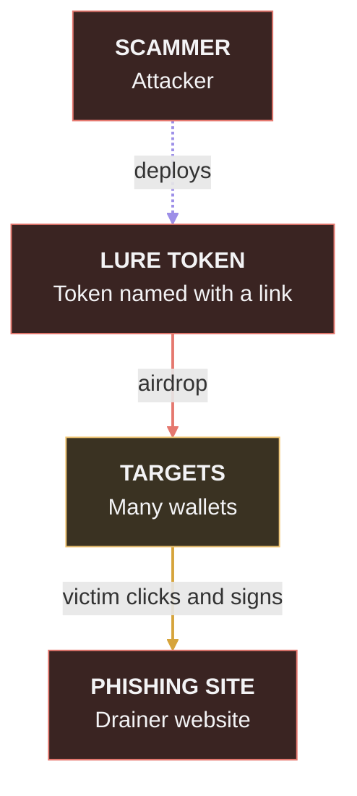

**Step by step.**

1. The attacker names the token something like "Claim reward at usdt-bonus.xyz" or puts instructions in the symbol.
2. The token is airdropped to many wallets. It appears in the wallet's token list.
3. Curious holders open the link. The site asks them to connect and sign, which drains them.
4. This tool flags URLs and instruction words in token names and shows names only as plain text, never as links.

**Detection.** L6 flags URLs and instruction words in name/symbol. Text is rendered as plain text, never as a link.

**Rule (L6, L8).** `name-url` / `name-instructions` findings. Names render as text only

**Tests.** `tokenRisk`: "A7 URL / instructions in token name"; `security`: "a token name with HTML is rendered as text, never parsed"

**Reproduced on a local chain.**

- `A7-url-name`: Token name carries a link and a lure → FAKE; L2.identity fail; L6: name-url, name-instructions, impersonates-usdt, mint

**Real-world case.** *Etherscan masks unknown token names.* Etherscan shows tokens of unknown reputation as masked names to fight address poisoning and spoofing, because anyone can set a token name to anything. Source: [Etherscan knowledge base](https://kb.etherscan.com/what-is-masked-token-name-and-symbol).

### A36 Tampered address in the request

**Severity:** Medium · **Chains:** All · **Layer(s):** L0

**Mechanism.** Gives an "expected recipient" or destination with one character changed, or EIP-55 casing broken by an edit.

**What the victim sees.** Their own address, apparently.

**Attack flow.**

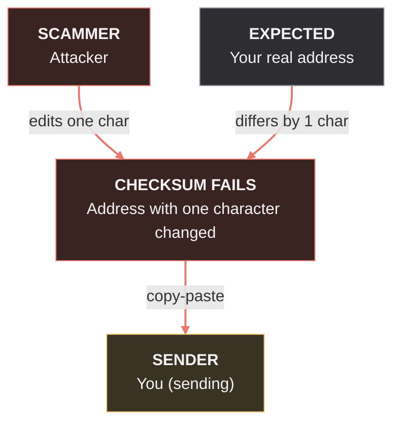

**Step by step.**

1. The attacker gives you an address that differs from the real one by a single character.
2. People compare only the first and last characters, so the changed character is missed.
3. A mixed-case EVM address carries a checksum in its capital letters. A manual edit usually breaks it.
4. This tool refuses a mixed-case address with a wrong checksum, and a Tron address with a bad checksum.

**Detection.** Mixed-case EVM input must pass EIP-55. Tron input must pass the base58check checksum. Otherwise refused.

**Rule (L0).** Mixed-case EVM address must pass EIP-55. Tron address must pass base58check

**Tests.** `input`: "A36 rejects an EIP-55 checksum mismatch (one character case-flipped)", "Tron base58check round-trip, and a one-char typo fails the checksum"

**Real-world case.** *More than 12,000 ETH lost to one-character typos.* A 2018 study by Johannes Pfeffer, reported in 2021, found about 12,622 ETH sent to addresses that differ by a single character from an address in use. EIP-55 casing was created to catch this. Source: [Fourmilab](https://www.fourmilab.ch/scanalyzer/archives/2021/10/fat-fingermore-than-12000-ethereum-lost-in-typos.html).

## Flash-USDT behaviours

### B8 Expiring / revocable balance

**Severity:** Critical · **Chains:** EVM, Tron · **Layer(s):** L2, L6

**Mechanism.** Custom token whose balanceOf depends on time, or the owner later burns, blacklists or pauses.

**What the victim sees.** Balance present today, gone or frozen later.

**Attack flow.**

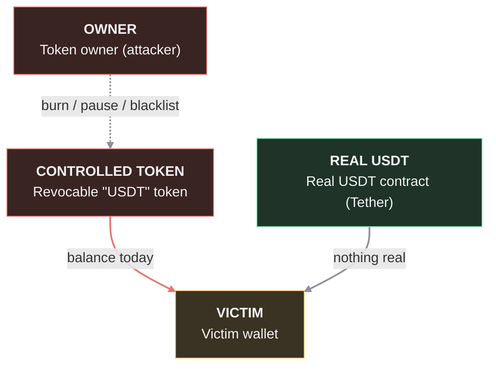

**Step by step.**

1. The attacker builds a token whose balance depends on time, or that the owner can burn, freeze or pause later.
2. Today the victim sees a balance. Tomorrow the owner burns it, blacklists the victim, or pauses transfers.
3. The balance was never backed by Tether. It only looked real for a while.
4. This tool already marks any non-official token FAKE. L6 adds the reasons: mint, burn, pause and blacklist functions, and a balance lower than the logged amount.

**Detection.** Not canonical, so already FAKE (L2). L6 explains it: burn(address,uint256), mint, pause, blacklist selectors, owner(), current balance lower than the logged amount.

**Rule (L2, L6).** Non-canonical → FAKE. L6 flags `burn(address,uint256)`, `mint`, `pause()`, blacklist selectors, and `holderBalance < loggedValue`

**Tests.** `tokenRisk`: "B8 expiring / revocable balance: burn-from, mint, pause, blacklist are flagged", "B8 event claims more than the holder has now -> event-without-balance"

**Reproduced on a local chain.**

- `B8-revocable`: Token the owner can burn / pause / blacklist, with expiring balance → FAKE; L6: burn-from, pause, blacklist, owner. After 2h the balance is 0 while the event said 5,000: event-without-balance

**Real-world case.** *The flash USDT scam explained.* The write-up describes balances that look real and vanish later, cannot be sold or moved, and are used to pressure victims to pay a "fee". Source: [Global Anti-Scam Organization](https://www.globalantiscam.org/post/unmasking-the-flash-usdt-scam-how-it-works-and-how-to-stay-safe).

### B9 Honeypot

**Severity:** High · **Chains:** EVM, Tron · **Layer(s):** L2, L6

**Mechanism.** transfer reverts for everyone except the owner/whitelist.

**What the victim sees.** Balance shows; sending or selling fails.

**Attack flow.**

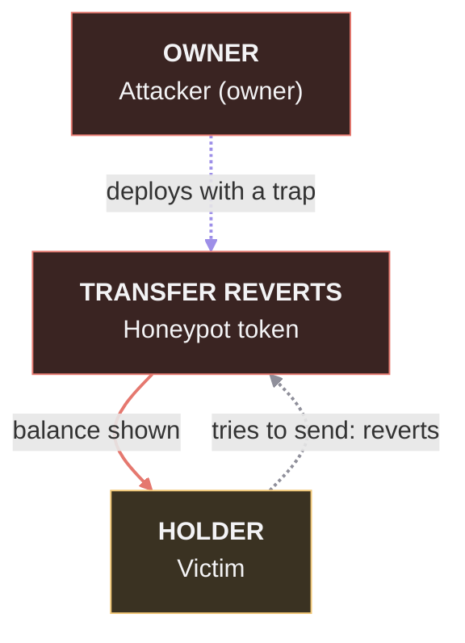

**Step by step.**

1. The attacker deploys a token where transfer() reverts for everyone except the owner or a whitelist.
2. The victim receives or buys it and sees a balance.
3. When the victim tries to send or sell, every attempt fails.
4. This tool simulates transfer(random, 1) from the holder with eth_call. A revert is flagged as a honeypot.

**Detection.** L6 simulates transfer(random, 1) from the holder with eth_call. A revert is flagged.

**Rule (L2, L6).** `eth_call transfer(random, 1)` from the holder. Revert → `honeypot`

**Tests.** `tokenRisk`: "B9 honeypot: simulated transfer by holder reverts"

**Reproduced on a local chain.**

- `B9-honeypot`: Honeypot: B holds a balance but cannot transfer it → FAKE; L6: honeypot (simulated transfer by B reverts)

**Real-world case.** *Honeypot tokens: easy to buy, impossible to sell.* Dedaub describes honeypots as tokens whose sell path is blocked through a hidden check, an auto-blacklist, a balance reset or a 100% sell tax, and says to simulate a real sell to detect them. Source: [Dedaub Tok{In}](https://tokin.dedaub.com/learn/honeypot).

### B10 Upgradeable proxy

**Severity:** Medium · **Chains:** EVM · **Layer(s):** L2, L6

**Mechanism.** Harmless today, swapped for malicious logic after the victim relies on it.

**What the victim sees.** Normal-looking token.

**Attack flow.**

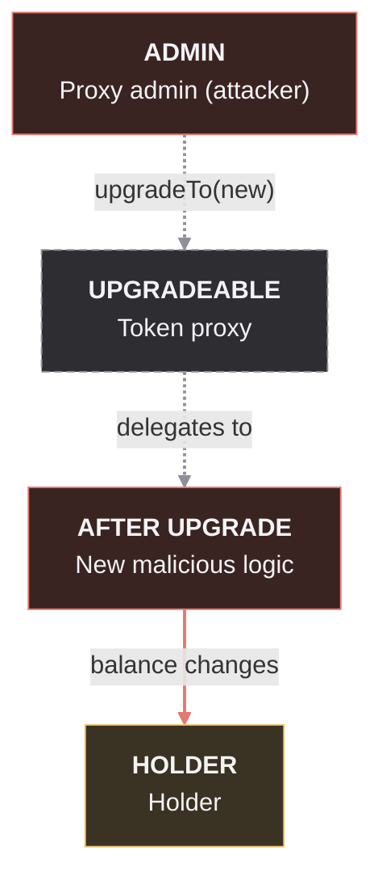

**Step by step.**

1. The attacker deploys a token behind an upgradeable proxy. Its code looks harmless at the time you look.
2. After you trust it, the owner upgrades the implementation to different code.
3. The new code can freeze balances, mint more, or steal approvals.
4. This tool reads the EIP-1967 implementation and beacon slots, spots EIP-1167 minimal proxies, and flags upgrade functions.

**Detection.** L6 reads EIP-1967 implementation/beacon slots, detects EIP-1167 minimal proxies and upgradeTo selectors.

**Rule (L2, L6).** Non-zero EIP-1967 implementation/beacon slot, EIP-1167 bytecode, or `upgradeTo` selectors → `proxy` / `upgradeable`

**Tests.** `tokenRisk`: "B10 upgradeable proxy via EIP-1967 slot", "B10 minimal proxy (EIP-1167) detected", "EIP-1967 implementation slot constant is correct"

**Reproduced on a local chain.**

- `B10-proxy`: Token behind an EIP-1967 proxy → FAKE; L6: proxy (EIP-1967 implementation slot set)

**Real-world case.** *OpenZeppelin UUPS upgrade vulnerability (2021).* OpenZeppelin disclosed a bug in the UUPS upgradeable base contract that could let an attacker take over a proxy implementation. Two independent researchers reported it, and no project lost funds. Source: [OpenZeppelin forum](https://forum.openzeppelin.com/t/uupsupgradeable-vulnerability-post-mortem/15680).

### B11 Lying balanceOf / events with no balance

**Severity:** Critical · **Chains:** EVM, Tron · **Layer(s):** L2, L6

**Mechanism.** balanceOf returns a big number for everyone, or the contract emits Transfer without changing storage.

**What the victim sees.** Explorer token tab and wallet both show the amount.

**Attack flow.**

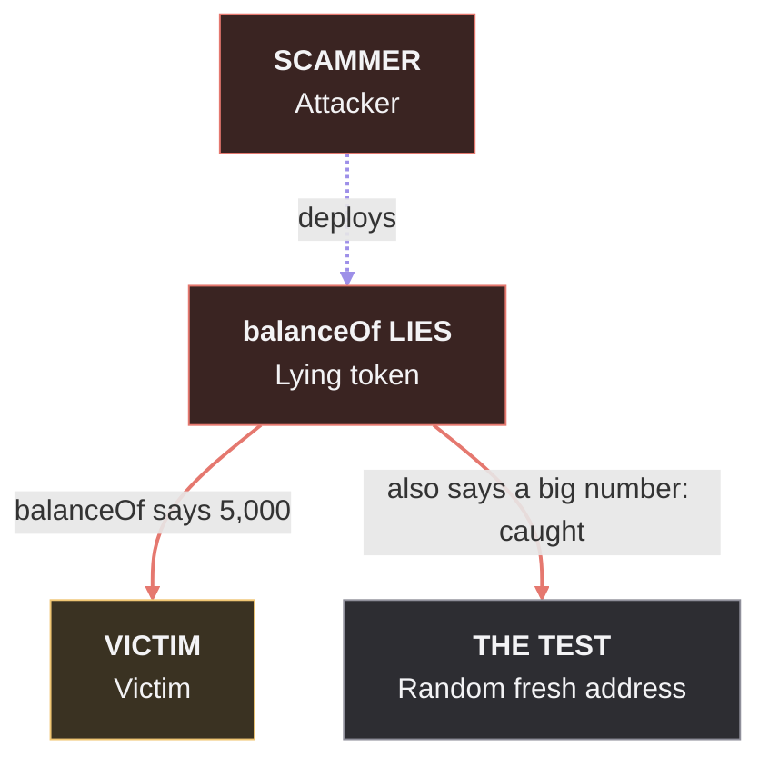

**Step by step.**

1. The attacker deploys a token where balanceOf returns a large number for any address, or emits Transfer events without changing storage.
2. The wallet and explorer ask the contract for balances. The contract lies.
3. The victim believes the balance exists. It is never backed by anything.
4. This tool calls balanceOf on a fresh random address. If that is not zero, the balances are fiction.

**Detection.** L6 calls balanceOf(random fresh address). A non-zero answer means the balances are fiction. It also compares the holder's balance with the event amount.

**Rule (L2, L6).** `balanceOf(fresh random address) > 0` → `fake-balance`. Event amount > holder balance → `event-without-balance`

**Tests.** `tokenRisk`: "B11 balanceOf lies: random fresh address has a balance"

**Reproduced on a local chain.**

- `B11-liar`: balanceOf lies; transfer only emits an event → FAKE; L6: fake-balance (a random fresh address "has" 1,000,000)

**Real-world case.** *Faked USDT balances reported by SlowMist.* SlowMist reported scammers who made victims see USDT balances that did not exist on chain. Source: [Bitcoin.com News](https://news.bitcoin.com/scammers-trick-crypto-users-with-faked-usdt-balances-slowmist-reports/).

### B12 Fee-on-transfer / rebasing

**Severity:** Medium · **Chains:** EVM · **Layer(s):** L3, L6

**Mechanism.** The token takes a fee or rebases, so the received amount differs from the event.

**What the victim sees.** Event says 1,000, balance grew by 950.

**Attack flow.**

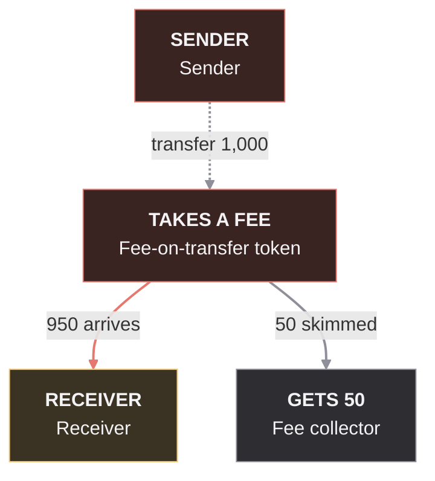

**Step by step.**

1. A token takes a fee on transfer, or changes balances itself (rebasing).
2. A transfer event says 1,000, but the receiver ends up with 950.
3. Software that adds up the event amounts credits too much.
4. Official USDT has no fee today. For decoys, this tool flags a balance that is lower than the logged amount.

**Detection.** Canonical USDT has no fee today (verify before each release: Tether's contract has a fee switch set to 0). For decoys, L6 flags balance < logged amount.

**Rule (L3, L6).** Canonical: the net amount comes from events (canonical USDT fee is 0; verify each release). Decoys: balance < logged → flagged

**Tests.** `tokenRisk`: "B12 fee-on-transfer / rebasing: credited less than the event said"

**Reproduced on a local chain.**

- `B12-fee-token`: Fee-on-transfer token: event says 1,000, balance grows by 950 → FAKE; L6: event-without-balance (950 held vs 1,000 logged)

**Real-world case.** *Balancer pools drained through deflationary tokens (June 2020).* Pools holding fee-charging tokens STA and STONK did not account for the fees, and an attacker drained about $450,000. SlowMist published the technical analysis. Source: [SlowMist](https://slowmist.medium.com/detailed-analysis-of-balancer-hack-de8bd86020de).

### B49 Token that self-destructs or changes code

**Severity:** Medium · **Chains:** EVM · **Layer(s):** L6

**Mechanism.** Token contract removed or replaced after the "payment".

**What the victim sees.** Token disappears, history is odd.

**Attack flow.**

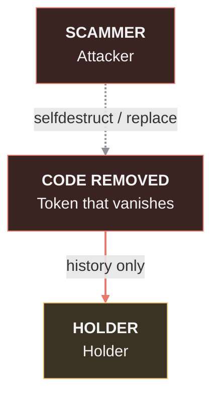

**Step by step.**

1. The attacker deploys a token and later removes the contract with selfdestruct, or replaces its code.
2. Old transactions still show the transfer in explorers.
3. But the token no longer exists, or behaves differently.
4. This tool checks whether there is code at the token address now and reports "no code at this address".

**Detection.** L6 reports "no code at this address now".

**Rule (L6).** `getCode(token) == 0x` → `no-code`

**Tests.** `tokenRisk`: "B49 token code gone (self-destructed) -> no-code"

**Real-world case.** *Tornado Cash governance takeover (May 2023).* REKT reports an attacker used CREATE2 with selfdestruct to replace the code at an address governance had already approved, then won control of governance votes. Source: [REKT](https://rekt.news/tornado-gov-rekt).

## Transaction deception

### C13 Forged Transfer events

**Severity:** Critical · **Chains:** EVM, Tron · **Layer(s):** L2, L3

**Mechanism.** A non-USDT contract emits Transfer(from = <exchange hot wallet>, to = victim, 10,000).

**What the victim sees.** Explorer token-transfer tab shows "From: Binance".

**Attack flow.**

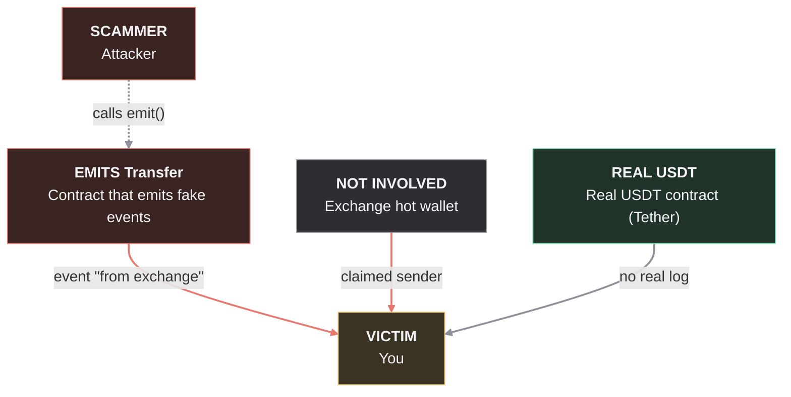

**Step by step.**

1. The attacker deploys a contract that can emit any event. They emit Transfer(from = a known exchange wallet, to = you, 10,000).
2. Block explorers index every log with the Transfer topic, so the token transfers tab shows "From: Binance".
3. No balance changed and no exchange sent anything. The event is theatre.
4. This tool only decodes logs emitted by the official USDT contract. Every other log is listed under decoys.

**Detection.** Only logs whose emitting address is the canonical contract are decoded. Every other Transfer-like log is listed under "Decoys found" with the reason.

**Rule (L2, L3).** Only canonical-emitter logs are decoded. Others go to `decoys[]` with a reason

**Tests.** `verifyTx`: "C13 Transfer event \"from Binance\" emitted by a non-USDT contract -> FAKE" (synthetic sender)

**Reproduced on a local chain.**

- `C13-forged-event`: Forger contract emits Transfer(A, B, 10,000) and moves nothing → FAKE; decoy listed: "Emitted by 0x..., not the canonical USDT contract"

**Real-world case.** *Spoofed token transfers right after the Monad launch.* Decrypt reports attackers deploying their own contracts that emit events looking like real transfers, though no wallet signed anything and no tokens moved, and explorers showed them as normal activity. Source: [Decrypt](https://decrypt.co/350053/monad-hit-spoofed-token-transfers-days-after-mainnet-launch).

### C14 Mixed tx

**Severity:** Critical · **Chains:** EVM, Tron · **Layer(s):** L3, L4

**Mechanism.** One tx moves 1 real USDT plus 4,999 fake USDT to the victim.

**What the victim sees.** "5,000 USDT received".

**Attack flow.**

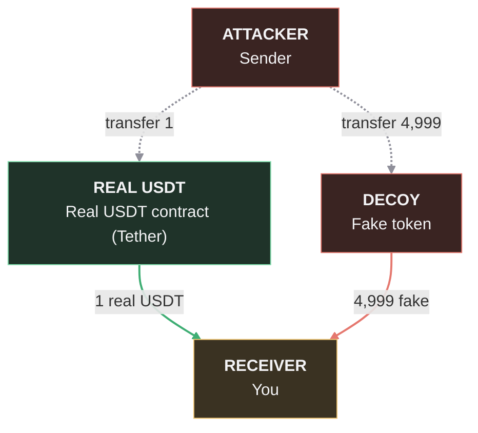

**Step by step.**

1. One transaction sends you 1 real USDT and 4,999 of a fake token.
2. A parser that adds up all Transfer events reports "5,000 USDT received".
3. Only 1 USDT is real.
4. This tool sums only the official contract's logs and lists decoys that credit you. The expected amount check then fails.

**Detection.** Sum canonical logs only. Decoys that credit the target make the verdict at least UNVERIFIED. The expected-amount check then FAILs.

**Rule (L3, L4).** Sum canonical logs only. A decoy crediting the target → `L3.decoys` warn. `L4.amount` compares the net amount with the expected amount

**Tests.** `verifyTx`: "C14 mixed tx: tiny real USDT + big fake: amount is the real part only, decoy warned", "C14 mixed tx without expected amount is still not VERIFIED (decoy credits you)"; real fixture: "BSC real swap: canonical USDT credited, other token leg listed as decoy, not added"

**Reproduced on a local chain.**

- `C14-mixed`: One tx: 1 real USDT + 4,999 fake USDT to B → FAKE with expected 5,000 (net is 1); UNVERIFIED without expected amount (decoy credits you)

**Real-world case.** *False top-up attacks on exchanges.* SlowMist describes "false top-up" attacks, where counterfeit transaction data makes an exchange credit a deposit that was never really paid, and recommends multiple confirmations and reconciliation. Source: [SlowMist](https://slowmist.medium.com/how-does-the-false-top-up-attack-break-through-the-defense-of-the-exchange-d6e8ebb434f5).

### C15 Reverted tx as proof

**Severity:** High · **Chains:** All · **Layer(s):** L1

**Mechanism.** Sends a tx that reverts (status 0). Input data still decodes to transfer(victim, 5000).

**What the victim sees.** Screenshot or decoded input showing the transfer.

**Attack flow.**

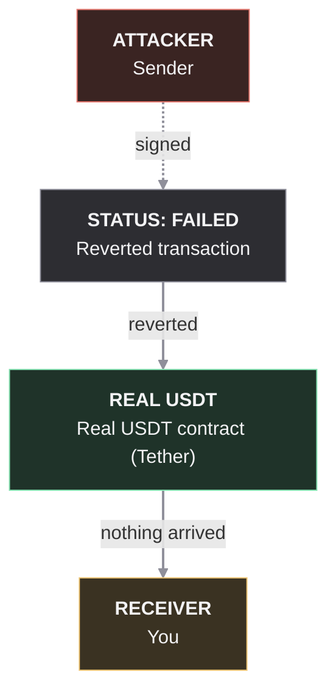

**Step by step.**

1. The attacker sends a transaction that reverts (status 0). Its input data still reads transfer(you, 5000).
2. A screenshot or a decoded-input view shows the intended transfer.
3. The chain recorded a failure. No state changed and no USDT moved.
4. This tool reads the receipt. If the status is not success, the result is FAKE.

**Detection.** status must be success. Reverted = FAKE.

**Rule (L1).** `receipt.status != success` → `L1.status` fail → FAKE

**Tests.** `verifyTx`: "C15 reverted tx whose input says transfer(victim, 5000) -> FAKE"

**Reproduced on a local chain.**

- `C15-reverted`: Reverted transfer(B, 5,000) shown as proof → FAKE; L1.status fail (reverted)

**Real-world case.** *Fake transaction records used as proof.* imToken warns about fake transaction records, and says to verify the contract and the transfer on the token page before believing a payment happened. Source: [imToken support](https://support.token.im/hc/en-us/articles/17009391596697-Be-wary-of-the-fake-transaction-record-scam).

### C16 Pending / replaced tx

**Severity:** High · **Chains:** EVM · **Layer(s):** L1

**Mechanism.** Broadcasts with a low fee, shows the pending hash, then replaces it (same nonce) or lets it drop.

**What the victim sees.** "Pending" tx with the right amount.

**Attack flow.**

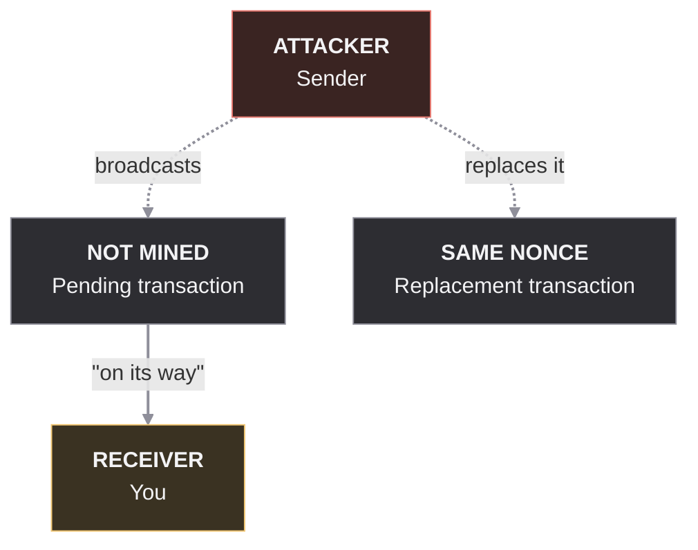

**Step by step.**

1. The attacker broadcasts a payment with a low fee and shows you the pending hash.
2. They then replace it (same nonce) or let it drop, so the payment never lands.
3. You release goods against a transaction that was never mined.
4. This tool treats pending or unknown as NOT RECEIVED, and only accepts finalized blocks.

**Detection.** Pending or unknown = NOT RECEIVED.

**Rule (L1).** Every answering provider says pending/notfound → `L1.found` fail (notReceived) → NOT RECEIVED

**Tests.** `verifyTx`: "C16 pending tx shown as proof -> NOT RECEIVED"

**Reproduced on a local chain.**

- `C16-pending`: Pending tx shown as proof, then dropped → NOT RECEIVED while pending; NOT RECEIVED after it is dropped

**Real-world case.** *Zero-confirmation payments can be replaced.* A research guide explains the classic attack: pay with transaction A, then broadcast a conflicting transaction B that sends the coins elsewhere, so the receiver loses the payment if B is mined. Source: [Spark research](https://www.spark.money/research/zero-conf-bitcoin-explained).

### C17 Not final / reorg

**Severity:** Medium · **Chains:** All · **Layer(s):** L1

**Mechanism.** Shows a tx in a block that is not final yet, hoping for a reorg or minority fork.

**What the victim sees.** 1–2 confirmations.

**Attack flow.**

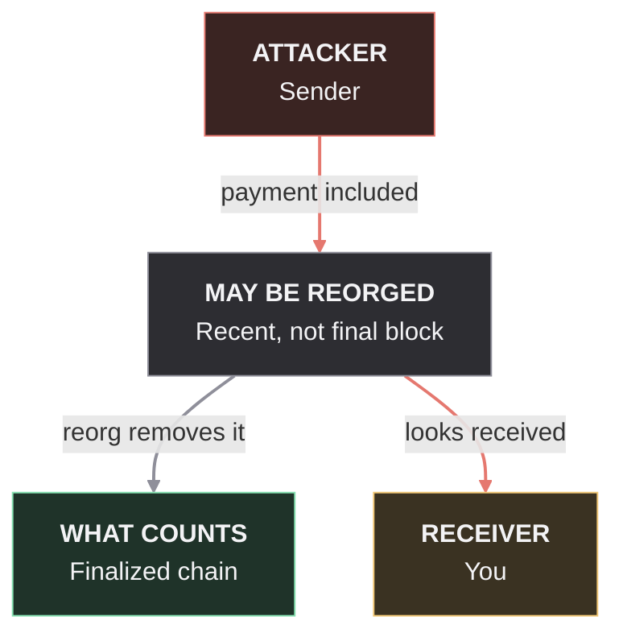

**Step by step.**

1. The attacker shows a transaction that is only one or two blocks deep.
2. A short fork or a reorg removes the block that held it.
3. Your "received" payment disappears.
4. This tool requires the block to be at or below the chain's finalized height (or a confirmation fallback). Otherwise the result is UNVERIFIED.

**Detection.** Must be ≤ finalized block (BSC fast finality, ETH finalized, Tron solidified). Otherwise UNVERIFIED. Fallback: 30 / 96 / 20 confirmations.

**Rule (L1).** `block ≤ finalized` (EVM `finalized` tag, Tron solidified), else warn. Fallback confirmations: BSC 30, ETH 96, Tron 20

**Tests.** `verifyTx`: "C17 included but not finalized -> UNVERIFIED", "C17 fallback to confirmation count when finalized tag is missing"; "in a block but not yet solidified -> UNVERIFIED"

**Reproduced on a local chain.**

- `C17-not-final`: Included in a block but not finalized, then finalized → UNVERIFIED (L1.finality warn) right after; VERIFIED once finalized

**Real-world case.** *Seven-block reorg on the Ethereum beacon chain (May 25, 2022).* Barnabé Monnot visualised a 7-block reorg of the beacon chain. Blocks near the head were replaced even though finality was not affected. Source: [Barnabé Monnot](https://barnabe.substack.com/p/pos-ethereum-reorg).

### C18 Real tx, wrong context

**Severity:** Critical · **Chains:** All · **Layer(s):** L4

**Mechanism.** Shows a real payment to someone else, an old payment, the same tx to several victims, or a smaller amount.

**What the victim sees.** A genuine explorer page.

**Attack flow.**

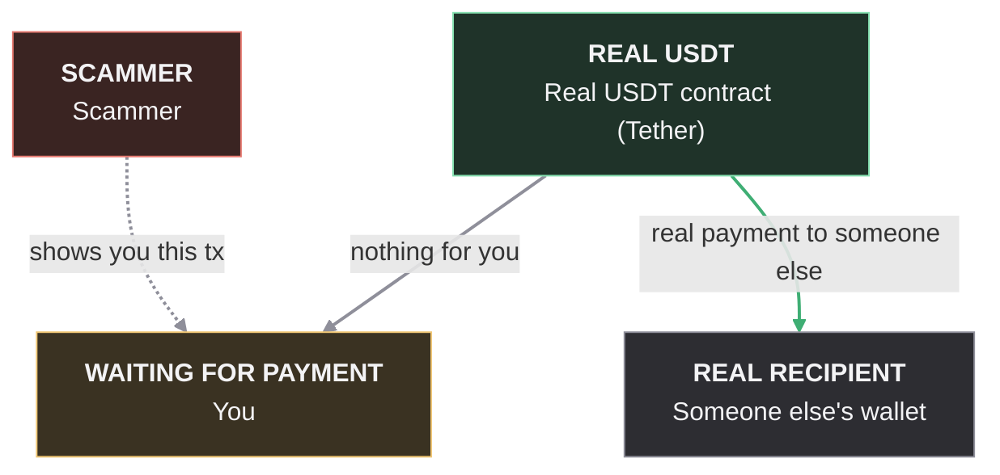

**Step by step.**

1. The attacker finds a real payment from someone else, an old payment, or a smaller payment.
2. They show you the genuine explorer page. The transaction is real.
3. But it was not to your address, not for this deal, or not this amount. Or the same hash is shown to many victims.
4. This tool needs your address and checks the recipient, amount, time, and whether the hash was used before.

**Detection.** Expected recipient (required for VERIFIED), expected amount, "deal started at" vs block time, and a local list of already-accepted hashes.

**Rule (L4).** `L4.recipient` (required), `L4.amount`, `L4.time` (block time ≥ deal start), `L4.reuse` (localStorage)

**Tests.** `verifyTx`: "C18 real payment to someone else -> FAKE for my address", "C18 old payment reused for a new deal (not-before) -> FAKE", "C18 same hash shown twice -> UNVERIFIED with reuse warning", "C18 no recipient given -> UNVERIFIED (cannot bind context)"

**Reproduced on a local chain.**

- `C18-wrong-context`: Real payment to someone else; old payment reused; same hash twice → wrong recipient: FAKE; old payment vs deal start: FAKE; reused hash: UNVERIFIED; no recipient given: UNVERIFIED

**Real-world case.** *The P2P triangle scam.* The Binance Blog describes two scammers working together: a genuine buyer pays one of them, and the other places a matching order and shows that same real payment as proof, so the seller releases crypto for money that was never theirs. Source: [Binance Blog](https://www.binance.com/en/square/post/610733).

### C19 In and out in the same tx

**Severity:** High · **Chains:** EVM · **Layer(s):** L3

**Mechanism.** USDT goes to the victim and is pulled back (via a prior approval) inside the same tx.

**What the victim sees.** Incoming Transfer event.

**Attack flow.**

```mermaid
flowchart TD
  n0["<b>ATTACKER</b><br/>Attacker"]
  n1["<b>REAL USDT</b><br/>Real USDT contract (Tether)"]
  n2["<b>RECEIVER</b><br/>You"]
  n0 ==>|"+5,000 in"| n2
  n2 ==>|"-5,000 pulled back"| n0
  n0 -.->|"both in one tx"| n1
  style n0 fill:#3a2422,stroke:#e5786f,color:#f3f3f5
  style n1 fill:#1f3329,stroke:#85e0b0,color:#f3f3f5
  style n2 fill:#3a3222,stroke:#f0c674,color:#f3f3f5
  linkStyle 0 stroke:#3fae74,stroke-width:2px
  linkStyle 1 stroke:#3fae74,stroke-width:2px
  linkStyle 2 stroke:#8f8f9a,stroke-width:2px
```

**Step by step.**

1. In one transaction USDT goes to you, and is pulled back out using a prior approval.
2. The Transfer event "to you" is visible. The pull-back is another event.
3. Net, you received nothing.
4. This tool computes the net change of the official USDT per address inside the transaction.

**Detection.** Net canonical change for the target address per tx.

**Rule (L3).** Net canonical change per address within the tx

**Tests.** `verifyTx`: "C19 USDT in and out in the same tx: net zero -> FAKE"

**Reproduced on a local chain.**

- `C19-in-and-out`: USDT credited to B and pulled back in the same tx → FAKE; net 0 (100 in, 100 out in one tx)

**Real-world case.** *Fake deposit bug in THORChain (2021).* SlowMist published an analysis of a fake-deposit vulnerability in THORChain's cross-chain system. Source: [SlowMist](https://slowmist.medium.com/analysis-of-the-fake-deposit-vulnerability-in-thorchains-cross-chain-system-dacabcb932da).

### C20 Malformed / wrong-object hash

**Severity:** Medium · **Chains:** All · **Layer(s):** L0

**Mechanism.** Shares a hash of the wrong length, a block hash, or an address.

**What the victim sees.** "Here's the hash".

**Attack flow.**

```mermaid
flowchart TD
  n0["<b>SCAMMER</b><br/>Scammer"]
  n1["<b>WRONG OBJECT</b><br/>Block hash or address"]
  n2["<b>VICTIM</b><br/>You"]
  n0 -.->|"shares as #quot;tx hash#quot;"| n1
  n1 ==>|"looks official"| n2
  style n0 fill:#3a2422,stroke:#e5786f,color:#f3f3f5
  style n1 fill:#2d2d32,stroke:#8f8f9a,color:#f3f3f5
  style n2 fill:#3a3222,stroke:#f0c674,color:#f3f3f5
  linkStyle 0 stroke:#8f8f9a,stroke-width:2px
  linkStyle 1 stroke:#e5786f,stroke-width:2px
```

**Step by step.**

1. The attacker gives you a block hash, an address, or a hash of the wrong length as "the transaction hash".
2. An explorer opens a block or address page that looks official.
3. It is not a payment.
4. This tool validates length and kind, refuses addresses, and says when you pasted a block hash.

**Detection.** L0 validates length/format and refuses addresses. If no tx is found, the hash is checked as a block hash and reported.

**Rule (L0).** Length/format validation. Address-as-hash refused. Not found → `isBlockHash` check → `L0.kind` fail

**Tests.** `input`: "C20 accepts a well-formed EVM hash and lowercases it", "C20 rejects wrong length", "C20 rejects an address pasted as a hash"; `verifyTx`: "C20 block hash given instead of tx hash -> FAKE with explanation"

**Reproduced on a local chain.**

- `C20-block-hash`: A block hash given instead of a tx hash → FAKE; "This is a block hash, not a transaction hash"

**Real-world case.** *Tokens sent to the wrong object are lost.* The EIP-223 issue explains that ERC-20 tokens sent to a contract that cannot handle them get stuck at that address, a common mistake when the destination is not a normal wallet. Source: [Ethereum EIPs (GitHub)](https://github.com/ethereum/EIPs/issues/223).

### C37 Payment via router / multicall

**Severity:** Low · **Chains:** EVM · **Layer(s):** L3

**Mechanism.** Pays through a contract, so tx.to is not the USDT contract.

**What the victim sees.** Real tx with an odd "to".

**Attack flow.**

```mermaid
flowchart TD
  n0["<b>SENDER</b><br/>Payer"]
  n1["<b>tx.to</b><br/>Router or multicall"]
  n2["<b>REAL USDT</b><br/>Real USDT contract (Tether)"]
  n3["<b>RECEIVER</b><br/>Receiver"]
  n0 -.->|"calls"| n1
  n1 -.->|"calls transfer"| n2
  n2 ==>|"real USDT"| n3
  style n0 fill:#2d2d32,stroke:#8f8f9a,color:#f3f3f5
  style n1 fill:#2d2d32,stroke:#8f8f9a,color:#f3f3f5,stroke-dasharray:5 3
  style n2 fill:#1f3329,stroke:#85e0b0,color:#f3f3f5
  style n3 fill:#3a3222,stroke:#f0c674,color:#f3f3f5
  linkStyle 0 stroke:#8f8f9a,stroke-width:2px
  linkStyle 1 stroke:#8f8f9a,stroke-width:2px
  linkStyle 2 stroke:#3fae74,stroke-width:2px
```

**Step by step.**

1. A payment is made through a router or multicall contract, so the transaction's "to" is not the USDT contract.
2. A checker that requires tx.to == USDT rejects a real payment, or one that trusts tx.to can be fooled.
3. The truth is in the logs, not in tx.to.
4. This tool only reads the official contract's logs and never uses tx.to.

**Detection.** Decisions use logs only, never tx.to.

**Rule (L3).** Logs only; `tx.to` is never used in a decision

**Tests.** `verifyTx`: "C37 payment through a router/multicall (tx.to is not USDT) still counts by logs"

**Reproduced on a local chain.**

- `C37-router`: Payment routed through a contract (tx.to is not USDT) → VERIFIED; decisions use logs, never tx.to

**Real-world case.** *Deposits through contracts are missed by some systems.* Etherscan explains that a transfer made by a contract shows under the Internal Transactions tab, not as a plain transfer, which is why some receivers do not see it as a normal payment. Source: [Etherscan knowledge base](https://info.etherscan.com/transaction-marked-success-but-i-cant-see-my-funds-why).

### C38 Native coin / TRC10 "USDT"

**Severity:** High · **Chains:** Tron, EVM · **Layer(s):** L2

**Mechanism.** Sends TRX/BNB, or a TRC10 asset named "USDT" (TRC10 transfers emit no TRC20 log).

**What the victim sees.** "USDT" in a wallet that lists TRC10 assets.

**Attack flow.**

```mermaid
flowchart TD
  n0["<b>SCAMMER</b><br/>Attacker"]
  n1["<b>NOT TRC20</b><br/>TRC10 asset named #quot;USDT#quot;"]
  n2["<b>REAL USDT</b><br/>Official TRC20 USDT"]
  n3["<b>RECEIVER</b><br/>Receiver"]
  n0 -.->|"issues"| n1
  n1 ==>|"shown as USDT"| n3
  n2 -->|"no real log"| n3
  style n0 fill:#3a2422,stroke:#e5786f,color:#f3f3f5
  style n1 fill:#3a2422,stroke:#e5786f,color:#f3f3f5
  style n2 fill:#1f3329,stroke:#85e0b0,color:#f3f3f5
  style n3 fill:#3a3222,stroke:#f0c674,color:#f3f3f5
  linkStyle 0 stroke:#9d8fe8,stroke-width:2px
  linkStyle 1 stroke:#e5786f,stroke-width:2px
  linkStyle 2 stroke:#8f8f9a,stroke-width:2px
```

**Step by step.**

1. The attacker sends TRX, BNB, or a TRC10 asset named "USDT".
2. A wallet that lists many asset types shows "USDT".
3. No TRC20 transfer from the official contract happened.
4. This tool requires a log from the official TRC20 contract. Anything else is FAKE.

**Detection.** No canonical TRC20 log, so FAKE.

**Rule (L2).** No canonical TRC20 log → `L2.identity` fail

**Tests.** `verifyTx`: "C38 Tron TRC10 / native \"USDT\" (no TRC20 log from the canonical contract) -> FAKE"

**Real-world case.** *TRC10 tokens on Tronscan flagged unsafe.* A TRON DAO forum thread by a token issuer reports new TRC10 tokens getting an "unsafe" status, saying TRC10 is mostly used for spam today. Source: [TRON DAO forum](https://forum.trondao.org/t/trc-10-on-tronscan-got-unsafe-status/22939).

### C40 Split view / minority fork

**Severity:** Medium · **Chains:** All · **Layer(s):** L1

**Mechanism.** Gets the victim to look at a node or explorer following a minority chain.

**What the victim sees.** A tx that "exists".

**Attack flow.**

```mermaid
flowchart TD
  n0["<b>SCAMMER</b><br/>Attacker"]
  n1["<b>NOT THE MAIN CHAIN</b><br/>Minority fork or fake node"]
  n2["<b>WHAT COUNTS</b><br/>Main chain"]
  n3["<b>VICTIM</b><br/>You"]
  n0 -.->|"controls"| n1
  n1 ==>|"shows a payment"| n3
  n2 -->|"no payment"| n3
  style n0 fill:#3a2422,stroke:#e5786f,color:#f3f3f5
  style n1 fill:#2d2d32,stroke:#8f8f9a,color:#f3f3f5
  style n2 fill:#1f3329,stroke:#85e0b0,color:#f3f3f5
  style n3 fill:#3a3222,stroke:#f0c674,color:#f3f3f5
  linkStyle 0 stroke:#8f8f9a,stroke-width:2px
  linkStyle 1 stroke:#e5786f,stroke-width:2px
  linkStyle 2 stroke:#8f8f9a,stroke-width:2px
```

**Step by step.**

1. The attacker controls a node or explorer on a minority fork, or a private chain with a longer history.
2. It shows a transaction that does not exist on the main chain.
3. Looking at one data source, you accept it.
4. This tool asks two independent providers and requires identical answers plus finality.

**Detection.** Two independent RPCs must agree, plus finality.

**Rule (L1).** Byte-identical receipts from ≥2 providers + finality

**Tests.** `verifyTx`: the F30 tests, "C17 included but not finalized -> UNVERIFIED"

**Real-world case.** *Ethereum Classic 51% attack (January 2019).* Coinbase detected deep chain reorganizations on Ethereum Classic that included double spends and paused the network. Roughly 219,500 ETC was double-spent across 20 reorgs, per the report. Source: [Security Affairs](https://securityaffairs.com/79628/hacking/ethereum-classic-51-attack.html).

## Address poisoning

### D21 Zero-value transferFrom from the victim

**Severity:** High · **Chains:** EVM, Tron · **Layer(s):** L5, L7

**Mechanism.** Calls transferFrom(victim, lookalike, 0). Many tokens allow zero-amount transfers without allowance.

**What the victim sees.** A 0-value outgoing transfer "from me" to an address that looks like one I use.

**Attack flow.**

```mermaid
flowchart TD
  n0["<b>SENDER OF THE TX</b><br/>Attacker"]
  n1["<b>MATCHES YOUR START AND END</b><br/>Lookalike address"]
  n2["<b>ADDRESS YOU USE</b><br/>Your real contact"]
  n3["<b>VICTIM</b><br/>Your wallet"]
  n0 -.->|"signs transferFrom"| n3
  n3 -.->|"0 USDT (not signed by you)"| n1
  n2 -->|"looks the same"| n1
  style n0 fill:#3a2422,stroke:#e5786f,color:#f3f3f5
  style n1 fill:#3a2422,stroke:#e5786f,color:#f3f3f5
  style n2 fill:#2d2d32,stroke:#8f8f9a,color:#f3f3f5
  style n3 fill:#3a3222,stroke:#f0c674,color:#f3f3f5
  linkStyle 0 stroke:#8f8f9a,stroke-width:2px
  linkStyle 1 stroke:#d6a43c,stroke-width:2px
  linkStyle 2 stroke:#e5786f,stroke-width:2px
```

**Step by step.**

1. The attacker generates an address that matches the first and last characters of an address you really use.
2. They call transferFrom(you, lookalike, 0). Many tokens allow a zero-amount transfer without any allowance.
3. Your history now shows an outgoing transfer of 0 from you to the lookalike, though you signed nothing.
4. When you later copy "the last address you paid" from history, you copy the lookalike.
5. This tool flags an outgoing zero-value transfer where the transaction sender is not you.

**Detection.** Wallet scan: an outgoing zero-value transfer that I did not sign (tx sender ≠ me).

**Rule (L5, L7).** Outgoing `value == 0` transfer where the tx sender ≠ the scanned address → `zero-value`

**Tests.** `wallet`: "D21 zero-value transfer \"from me\" that I did not sign"

**Reproduced on a local chain.**

- `D21-zero-value`: Zero-value transferFrom(B, lookalike, 0) planted by the attacker → scan: zero-value poisoning from 0xf39fd6ff..., imitates A (first/last 6/9 chars). Send check: LOOKALIKE

**Real-world case.** *How address poisoning works, in depth.* Blockaid explains how attackers plant lookalike addresses in a victim's history, including zero-value transfers that need no token balance. Source: [Blockaid](https://www.blockaid.io/blog/a-deep-dive-into-address-poisoning).

### D22 Vanity dust

**Severity:** Critical · **Chains:** EVM, Tron · **Layer(s):** L3, L5

**Mechanism.** Sends tiny real or fake USDT from a vanity address matching the first/last 4–6 characters of an address the victim uses (including their Binance deposit address).

**What the victim sees.** Small incoming transfer from a "familiar" address.

**Attack flow.**

```mermaid
flowchart TD
  n0["<b>GENERATES LOOKALIKES</b><br/>Attacker"]
  n1["<b>FAKE CONTACT</b><br/>Vanity lookalike"]
  n2["<b>REAL ADDRESS</b><br/>Contact you really pay"]
  n3["<b>VICTIM</b><br/>Your wallet"]
  n0 -.->|"creates"| n1
  n1 -.->|"dust payment"| n3
  n2 -->|"same start and end"| n1
  style n0 fill:#3a2422,stroke:#e5786f,color:#f3f3f5
  style n1 fill:#3a2422,stroke:#e5786f,color:#f3f3f5
  style n2 fill:#2d2d32,stroke:#8f8f9a,color:#f3f3f5
  style n3 fill:#3a3222,stroke:#f0c674,color:#f3f3f5
  linkStyle 0 stroke:#9d8fe8,stroke-width:2px
  linkStyle 1 stroke:#d6a43c,stroke-width:2px
  linkStyle 2 stroke:#e5786f,stroke-width:2px
```

**Step by step.**

1. The attacker watches who you pay, then grinds out a vanity address with the same first and last characters.
2. They send you a tiny amount (dust) of real or fake USDT from that address.
3. It shows in your history. A truncated view like 0x1234…abcd looks like your contact.
4. This tool compares addresses with your watchlist and people you really paid, and flags prefix and suffix matches.

**Detection.** Prefix/suffix match (≥3 each, ≥7 total) or edit distance ≤2 against watchlist + addresses the user really paid. Dust < 0.01 USDT reported. In Verify tx, net < 1 USDT = UNVERIFIED.

**Rule (L3, L5).** `isLookalike`: prefix ≥3 and suffix ≥3 and sum ≥7, or edit distance ≤2, against watchlist + addresses really paid. Dust < 0.01 USDT reported. Verify tx: net < 1 USDT → warn

**Tests.** `wallet`: "D22 dust from a vanity lookalike of an address I paid", "D22 plain dust from an unrelated address is still reported", "prefix+suffix vanity match is a lookalike; identical or unrelated are not", "one swapped character is a lookalike (edit distance)", "Tron lookalikes are judged on the base58 form people read"; `verifyTx`: "D22 dust from a vanity address -> UNVERIFIED (dust)"

**Reproduced on a local chain.**

- `D22-vanity-dust`: Dust of real USDT from a vanity lookalike → scan: lookalike dust flagged. Verify: UNVERIFIED (0.001 USDT is dust)

**Real-world case.** *Vanity lookalike addresses.* Etherscan explains attackers generating addresses that match the first and last characters of one you use, then sending a small transfer so it shows in your history. Source: [Etherscan knowledge base](https://kb.etherscan.com/what-is-address-poisoning).

### D23 Poisoned address copied at withdrawal

**Severity:** Critical · **Chains:** All · **Layer(s):** L5

**Mechanism.** Waits for the victim to copy the lookalike from history.

**What the victim sees.** Their "usual" address.

**Attack flow.**

```mermaid
flowchart TD
  n0["<b>SENDER</b><br/>You (sending)"]
  n1["<b>ATTACKER'S</b><br/>Poisoned address"]
  n2["<b>WHO YOU MEANT</b><br/>Intended receiver"]
  n3["<b>REAL USDT</b><br/>Real USDT contract (Tether)"]
  n0 ==>|"real USDT sent by mistake"| n1
  n2 -->|"looks the same"| n1
  n3 ==>|"moves to attacker"| n1
  style n0 fill:#3a3222,stroke:#f0c674,color:#f3f3f5
  style n1 fill:#3a2422,stroke:#e5786f,color:#f3f3f5
  style n2 fill:#2d2d32,stroke:#8f8f9a,color:#f3f3f5
  style n3 fill:#1f3329,stroke:#85e0b0,color:#f3f3f5
  linkStyle 0 stroke:#3fae74,stroke-width:2px
  linkStyle 1 stroke:#e5786f,stroke-width:2px
  linkStyle 2 stroke:#3fae74,stroke-width:2px
```

**Step by step.**

1. The lookalike address is already in your history from step D21 or D22.
2. When you make a withdrawal you copy "the usual address" from recent transactions.
3. You copy the attacker's address instead and send real USDT there.
4. This tool's "Before you send" check compares the destination with your saved addresses and shows a per-character diff.

**Detection.** "Check before sending" tab: LOOKALIKE warning with a per-character diff. Watchlist. Reminder to use the Binance withdrawal whitelist.

**Rule (L5).** `checkDestination` → LOOKALIKE with a per-character diff. `L5.lookalike` in Verify tx

**Tests.** `wallet`: "D23 lookalike of a watchlist address (e.g. my Binance deposit address)", "danger on lookalike, known on exact, unknown otherwise"; `verifyTx`: "D23 my expected recipient is a lookalike of my watched address -> warn"

**Real-world case.** *$68 million of WBTC sent to a poisoned address (May 2024).* Halborn describes a whale who sent 1,155 WBTC to a lookalike address after the attacker put it in their history with a 0 ETH transaction costing about $0.65 in gas. Source: [Halborn](https://www.halborn.com/blog/post/massive-68-million-address-poisoning-hack-underscores-ongoing-cyber-threat).

### D41 Weak lookalike (prefix only)

**Severity:** Medium · **Chains:** All · **Layer(s):** Residual · **Residual**

**Mechanism.** Matches only the first 4 characters, betting the victim checks only the start.

**What the victim sees.** Partially familiar address.

**Attack flow.**

```mermaid
flowchart TD
  n0["<b>NOT FLAGGED</b><br/>Prefix-only lookalike"]
  n1["<b>REAL ADDRESS</b><br/>Your real contact"]
  n2["<b>SENDER</b><br/>You"]
  n1 -->|"same first 4 only"| n0
  n0 -.->|"dust payment"| n2
  style n0 fill:#3a2422,stroke:#e5786f,color:#f3f3f5
  style n1 fill:#2d2d32,stroke:#8f8f9a,color:#f3f3f5
  style n2 fill:#3a3222,stroke:#f0c674,color:#f3f3f5
  linkStyle 0 stroke:#e5786f,stroke-width:2px
  linkStyle 1 stroke:#d6a43c,stroke-width:2px
```

*Documented residual risk: this tool tells you the address is new, not that it is hostile.*

**Step by step.**

1. The attacker matches only the first four characters of an address you use.
2. It is a weaker lookalike, relying on people who only check the start.
3. This tool does not flag a prefix-only match, because it would raise too many false alarms.
4. It still tells you "NEW address" before you send, which is your cue to check the whole thing.

**Detection.** Not caught by the lookalike rule (too many false positives). The send check still says "NEW address".

**Rule (**Residual**).** Prefix-only matches are deliberately not flagged (false positives). The send check says NEW

**Tests.** `wallet`: "a match on the first 4 characters only is NOT flagged (documented residual risk)"

**Reproduced on a local chain.**

- `D41-weak-lookalike`: Known limit: only the first 4 characters match → NOT flagged (documented residual risk D41); the send check still calls it a NEW address

**Real-world case.** *Carnegie Mellon study of address poisoning (2022 to 2024).* Researchers found over 270 million attempts on Ethereum and BSC, targeting over 17 million victims, with 6,633 successful transfers worth over $83.8 million. Source: [Tsuchiya, Dong, Soska, Christin (arXiv, USENIX Security 2025)](https://arxiv.org/abs/2501.16681).

### D42 Poisoning with fake tokens

**Severity:** High · **Chains:** EVM, Tron · **Layer(s):** L5, L6

**Mechanism.** Same as D22 but with a fake-USDT transfer of a matching amount.

**What the victim sees.** "Payment" from a familiar address.

**Attack flow.**

```mermaid
flowchart TD
  n0["<b>SCAMMER</b><br/>Attacker"]
  n1["<b>FAKE TOKEN</b><br/>Fake USDT token"]
  n2["<b>SENDER SHOWN</b><br/>Lookalike address"]
  n3["<b>VICTIM</b><br/>Your wallet"]
  n0 -.->|"deploys"| n1
  n1 ==>|"fake transfer from lookalike"| n3
  n2 -->|"looks like your contact"| n3
  style n0 fill:#3a2422,stroke:#e5786f,color:#f3f3f5
  style n1 fill:#3a2422,stroke:#e5786f,color:#f3f3f5
  style n2 fill:#3a2422,stroke:#e5786f,color:#f3f3f5
  style n3 fill:#3a3222,stroke:#f0c674,color:#f3f3f5
  linkStyle 0 stroke:#9d8fe8,stroke-width:2px
  linkStyle 1 stroke:#e5786f,stroke-width:2px
  linkStyle 2 stroke:#e5786f,stroke-width:2px
```

**Step by step.**

1. Same as D22, but the dust is a fake-token transfer that costs the attacker nothing real.
2. The fake token is named like USDT with an amount that matches a past payment.
3. Your history shows what looks like a payment from a familiar address.
4. This tool groups fake tokens that impersonate USDT and reports them with the lookalike.

**Detection.** Wallet scan, when the indexer is available (TronGrid on Tron; explorer key on EVM).

**Rule (L5, L6).** Lookalike rule applies to any token. Fake tokens grouped with `impersonatesUsdt`. Needs an indexer on EVM

**Tests.** `wallet`: "D42 poisoning with a fake token from a lookalike counts too"

**Reproduced on a local chain.**

- `D42-fake-token-poison`: Fake-USDT dust from a vanity lookalike, scanned → scan: fake "Tether USD" listed as FAKE USDT; its sender flagged as a lookalike of A

**Real-world case.** *DEA lost about $55,000 of USDT to a fake-token poisoning.* Scammers mirrored the first and last characters of a real wallet and airdropped a token into the lookalike address. Bitcoinist reports the DEA lost about $55,000 in seized USDT. Source: [Bitcoinist](https://bitcoinist.com/crypto-scammers-outwit-dea/amp/).

## Approvals and account control

### E24 Approval / permit phishing

**Severity:** Critical · **Chains:** EVM, Tron · **Layer(s):** L7

**Mechanism.** Tricks the victim into approve/increaseAllowance, a permit signature, or Permit2 with an unlimited allowance.

**What the victim sees.** Nothing until the drain.

**Attack flow.**

```mermaid
flowchart TD
  n0["<b>SCAMMER</b><br/>Phishing site"]
  n1["<b>VICTIM</b><br/>Your wallet"]
  n2["<b>REAL USDT</b><br/>Real USDT contract (Tether)"]
  n3["<b>CAN SPEND YOUR USDT</b><br/>Attacker spender"]
  n0 -.->|"asks you to sign"| n1
  n1 -->|"approve(unlimited)"| n2
  n2 -->|"allowance recorded"| n3
  n1 ==>|"later: all USDT pulled"| n3
  style n0 fill:#3a2422,stroke:#e5786f,color:#f3f3f5
  style n1 fill:#3a3222,stroke:#f0c674,color:#f3f3f5
  style n2 fill:#1f3329,stroke:#85e0b0,color:#f3f3f5
  style n3 fill:#3a2422,stroke:#e5786f,color:#f3f3f5
  linkStyle 0 stroke:#8f8f9a,stroke-width:2px
  linkStyle 1 stroke:#d6a43c,stroke-width:2px
  linkStyle 2 stroke:#d6a43c,stroke-width:2px
  linkStyle 3 stroke:#3fae74,stroke-width:2px
```

**Step by step.**

1. You visit a fake claim or mint site and are asked to sign a message that looks like a login.
2. The message is a permit or a Permit2 transfer authorisation for USDT, or you send an approve() transaction with an unlimited amount.
3. The attacker's spender contract now has permission to move your USDT. No funds have moved yet.
4. Later, or at once, the attacker calls transferFrom and sweeps your balance.
5. This tool lists live allowances (Approval logs plus a current allowance() call) and flags unlimited ones.

**Detection.** Wallet scan lists live USDT allowances (from Approval logs plus a current allowance() call). Unlimited = high.

**Rule (L7).** Approval logs (owner = me) → current `allowance(me, spender)`. ≥ 2^255 = unlimited/high, > 0 = medium

**Tests.** `wallet`: "E24 unlimited USDT approval to an unknown spender is high risk"

**Reproduced on a local chain.**

- `E24-approvals`: Unlimited and bounded USDT approvals, then revoke → scan: unlimited approval to attacker = high; 50 USDT = medium; after revoke it is gone

**Real-world case.** *PEPE holder loses $1.39M to a Permit2 signature (October 2024).* Decrypt reports, citing Scam Sniffer, a victim who signed an off-chain Permit2 message that gave the attacker unrestricted access, and the tokens were moved within about an hour. Source: [Decrypt](https://decrypt.co/286076/pepe-uniswap-permit2-phishing-attack).

### E25 EIP-7702 delegation phishing

**Severity:** Critical · **Chains:** ETH, BSC · **Layer(s):** L7

**Mechanism.** Gets the EOA to sign a 7702 authorization that delegates to a drainer contract. BSC enabled 7702 with the Pascal hardfork (verify).

**What the victim sees.** Nothing, until funds move automatically.

**Attack flow.**

```mermaid
flowchart TD
  n0["<b>SCAMMER</b><br/>Phishing site"]
  n1["<b>VICTIM</b><br/>Your account (EOA)"]
  n2["<b>DELEGATION TARGET</b><br/>Drainer contract"]
  n3["<b>RECEIVES FUNDS</b><br/>Attacker wallet"]
  n0 -.->|"asks you to sign 7702"| n1
  n1 -->|"delegates to"| n2
  n2 ==>|"sweeps funds out"| n3
  style n0 fill:#3a2422,stroke:#e5786f,color:#f3f3f5
  style n1 fill:#3a3222,stroke:#f0c674,color:#f3f3f5
  style n2 fill:#2d2d32,stroke:#8f8f9a,color:#f3f3f5,stroke-dasharray:5 3
  style n3 fill:#3a2422,stroke:#e5786f,color:#f3f3f5
  linkStyle 0 stroke:#8f8f9a,stroke-width:2px
  linkStyle 1 stroke:#d6a43c,stroke-width:2px
  linkStyle 2 stroke:#3fae74,stroke-width:2px
```

**Step by step.**

1. You are tricked into signing an EIP-7702 authorisation that points your account to a drainer contract.
2. Your address now has contract code that starts with 0xef0100 followed by the drainer's address.
3. It still looks like a normal wallet. Funds sent to it, or gas you add, can be swept automatically.
4. This tool reads getCode(your address) and shows the delegation target if there is one.

**Detection.** getCode(address) starting with 0xef0100 = delegated, with the target shown.

**Rule (L7).** `code == 0xef0100 ‖ 20 bytes` → delegated, target shown

**Tests.** `wallet`: "E25 EIP-7702 delegation code on an EOA is detected"

**Reproduced on a local chain.**

- `E25-7702`: EOA delegated to a contract with an EIP-7702 authorization → scan: delegated to 0x05b4cb12...

**Real-world case.** *Wintermute on EIP-7702 delegation abuse (June 2025).* The Block reports Wintermute found most EIP-7702 delegations pointed to one malicious sweeper script, nicknamed CrimeEnjoyor, which drains accounts with leaked keys. Source: [The Block](https://www.theblock.co/news/ecosystems/2025-06-01-wintermute-warns-pectra-upgrade-leaves-ethereum-users-at-risk-of-automated-attacks-356481).

### E26 Leaked-seed "free wallet with USDT" bait

**Severity:** High · **Chains:** Tron, EVM · **Layer(s):** L7, residual · **Residual**

**Mechanism.** Posts a seed phrase for a wallet holding USDT. On Tron the owner permission was moved to the attacker's key. On EVM a sweeper bot takes any gas you send.

**What the victim sees.** "Free" USDT you can't move; you send TRX/BNB for fees and lose it.

**Attack flow.**

```mermaid
flowchart TD
  n0["<b>POSTS THE SEED</b><br/>Attacker"]
  n1["<b>HONEYPOT</b><br/>Bait wallet with USDT"]
  n2["<b>VICTIM</b><br/>You"]
  n3["<b>COLLECTS GAS</b><br/>Attacker's other wallet"]
  n0 -.->|"shares the seed"| n2
  n2 ==>|"you add gas"| n1
  n1 ==>|"gas swept out at once"| n3
  style n0 fill:#3a2422,stroke:#e5786f,color:#f3f3f5
  style n1 fill:#2d2d32,stroke:#8f8f9a,color:#f3f3f5
  style n2 fill:#3a3222,stroke:#f0c674,color:#f3f3f5
  style n3 fill:#3a2422,stroke:#e5786f,color:#f3f3f5
  linkStyle 0 stroke:#8f8f9a,stroke-width:2px
  linkStyle 1 stroke:#3fae74,stroke-width:2px
  linkStyle 2 stroke:#3fae74,stroke-width:2px
```

**Step by step.**

1. The attacker posts a seed phrase for a "free" wallet that holds USDT.
2. You import it. You can see USDT, but to move it you need gas (TRX or ETH or BNB).
3. You send gas to that wallet. A script that watches it sends the gas out before your transaction runs. On Tron the attacker may also have moved the owner permission to their own key.
4. You lose your gas and the USDT stays locked.
5. This tool checks Tron owner permissions. A sweeper bot on EVM is behaviour it cannot see (residual).

**Detection.** Tron: owner permission keys ≠ the account itself → high risk. EVM sweeper: residual (behavioural).

**Rule (L7 (Tron); **Residual** (EVM sweeper)).** Tron: the owner permission must include the account's own key with weight ≥ threshold, and no other keys

**Tests.** `wallet`: "E26 leaked-seed bait / E27 permission hijack on Tron: owner key is someone else"

**Real-world case.** *Honeypot wallets with a sweeper script.* MetaMask explains the scam: you are shown a seed phrase for a wallet holding tokens, you send gas to move them, and a sweeper script moves the gas out before you can use it. Source: [MetaMask support](https://support.metamask.io/stay-safe/protect-yourself/social-engineering/honeypot-scams).

### E27 Tron energy scams / multi-sig hijack

**Severity:** High · **Chains:** Tron · **Layer(s):** L7

**Mechanism.** Sells fake "energy" or adds itself to the account permissions.

**What the victim sees.** Account behaves normally until it doesn't.

**Attack flow.**

```mermaid
flowchart TD
  n0["<b>ADDS A KEY</b><br/>Attacker"]
  n1["<b>VICTIM</b><br/>Your Tron account"]
  n2["<b>DEPOSITS STILL ARRIVE</b><br/>Anyone sending you USDT"]
  n0 -->|"adds own key, raises threshold"| n1
  n2 ==>|"deposits keep coming"| n1
  style n0 fill:#3a2422,stroke:#e5786f,color:#f3f3f5
  style n1 fill:#3a3222,stroke:#f0c674,color:#f3f3f5
  style n2 fill:#2d2d32,stroke:#8f8f9a,color:#f3f3f5
  linkStyle 0 stroke:#d6a43c,stroke-width:2px
  linkStyle 1 stroke:#3fae74,stroke-width:2px
```

**Step by step.**

1. The attacker gets a way to edit the account's permissions: leaked key, a signed permission change, or a fake "energy" service.
2. They add their key and raise the signing threshold so the owner alone can no longer sign.
3. The account still receives deposits and still looks normal.
4. This tool checks that the owner permission holds only your key with enough weight.

**Detection.** Same permission check as E26.

**Rule (L7).** Same permission rule

**Tests.** `wallet`: same test as E26

**Real-world case.** *Over 14,500 Tron addresses at risk of silent hijacking.* Cointelegraph reports how Tron account permissions can be changed so another key is needed to sign, locking out the owner while deposits still arrive. Source: [Cointelegraph](https://cointelegraph.com/news/tron-addresses-risk-silent-hijacking).

### E43 Clipboard hijacker

**Severity:** Critical · **Chains:** All · **Layer(s):** L5, residual · **Residual**

**Mechanism.** Malware replaces a copied address.

**What the victim sees.** A different address in the paste.

**Attack flow.**

```mermaid
flowchart TD
  n0["<b>ON YOUR DEVICE</b><br/>Clipper malware"]
  n1["<b>VICTIM</b><br/>You"]
  n2["<b>PASTED INSTEAD</b><br/>Attacker address"]
  n3["<b>WHO YOU MEANT</b><br/>Intended receiver"]
  n1 -.->|"copies address"| n0
  n0 -->|"replaces it"| n2
  n1 ==>|"USDT sent to attacker"| n2
  style n0 fill:#3a2422,stroke:#e5786f,color:#f3f3f5
  style n1 fill:#3a3222,stroke:#f0c674,color:#f3f3f5
  style n2 fill:#3a2422,stroke:#e5786f,color:#f3f3f5
  style n3 fill:#2d2d32,stroke:#8f8f9a,color:#f3f3f5
  linkStyle 0 stroke:#8f8f9a,stroke-width:2px
  linkStyle 1 stroke:#e5786f,stroke-width:2px
  linkStyle 2 stroke:#3fae74,stroke-width:2px
```

**Step by step.**

1. Malware runs on your device and watches the clipboard.
2. You copy your recipient's address.
3. The malware swaps it for the attacker's address.
4. You paste without checking and send real USDT to the attacker.
5. This tool's send check shows NEW or LOOKALIKE. The malware itself is on your device and is out of its reach.

**Detection.** The send check says NEW or LOOKALIKE. Device compromise itself is residual.

**Rule (L5; **Residual** (device)).** The send check never says KNOWN for an address outside the watchlist and recent payments

**Tests.** `wallet`: "E43 clipboard hijack to an unrelated address shows as NEW, never KNOWN"

**Real-world case.** *Clipper malware in a fake Tor Browser (2023).* Kaspersky reported a campaign affecting more than 15,000 users in 52 countries that swapped wallet addresses on the clipboard, with about $400,000 stolen so far in 2023. Source: [Kaspersky](https://www.kaspersky.com/about/press-releases/2023_new-clipper-malware-steals-us400000-in-cryptocurrencies-via-fake-tor-browser).

### E44 Approvals on other tokens / NFTs

**Severity:** Medium · **Chains:** EVM · **Layer(s):** Residual · **Residual**

**Mechanism.** setApprovalForAll, approvals on other tokens.

**What the victim sees.** —.

**Attack flow.**

```mermaid
flowchart TD
  n0["<b>SCAMMER</b><br/>Phishing site"]
  n1["<b>VICTIM</b><br/>Your wallet"]
  n2["<b>EXISTING APPROVAL</b><br/>Marketplace or other contract"]
  n3["<b>TAKES THE ASSETS</b><br/>Attacker"]
  n0 -.->|"asks you to sign"| n1
  n1 -->|"approval exists"| n2
  n2 -->|"assets moved"| n3
  style n0 fill:#3a2422,stroke:#e5786f,color:#f3f3f5
  style n1 fill:#3a3222,stroke:#f0c674,color:#f3f3f5
  style n2 fill:#2d2d32,stroke:#8f8f9a,color:#f3f3f5,stroke-dasharray:5 3
  style n3 fill:#3a2422,stroke:#e5786f,color:#f3f3f5
  linkStyle 0 stroke:#8f8f9a,stroke-width:2px
  linkStyle 1 stroke:#d6a43c,stroke-width:2px
  linkStyle 2 stroke:#8f8f9a,stroke-width:2px
```

**Step by step.**

1. You approve an NFT collection or another token, for example setApprovalForAll for a marketplace.
2. Phishing makes you sign something that lets the attacker use that approval.
3. The attacker moves your NFTs or tokens, not USDT.
4. This tool lists USDT approvals only. For other tokens and NFTs use a dedicated revoke tool.

**Detection.** Not covered: the scan lists canonical-USDT approvals only. Use a dedicated revoke tool.

**Rule (**Residual**).** Only canonical-USDT approvals are scanned

**Tests.** — (documented limit)

**Real-world case.** *OpenSea phishing: NFTs taken through existing approvals (February 2022).* Halborn explains how victims who signed a malicious order let the attacker use their existing marketplace approvals to take NFTs. Source: [Halborn](https://halborn.com/explained-the-opensea-phishing-hack-february-2022/).

## Off-chain and infrastructure

### F28 Edited screenshots, fake receipts, fake "Binance" messages

**Severity:** Critical · **Chains:** — · **Layer(s):** L1, residual · **Residual**

**Mechanism.** Photoshop, fake PDF, spoofed email/SMS/support chat.

**What the victim sees.** A convincing "payment confirmed".

**Attack flow.**

```mermaid
flowchart TD
  n0["<b>SCAMMER</b><br/>Scammer"]
  n1["<b>NOT ON CHAIN</b><br/>Edited screenshot or fake receipt"]
  n2["<b>VICTIM</b><br/>You"]
  n3["<b>TRUTH</b><br/>The chain"]
  n0 -.->|"makes"| n1
  n1 ==>|"#quot;payment confirmed#quot;"| n2
  n3 -->|"nothing there"| n2
  style n0 fill:#3a2422,stroke:#e5786f,color:#f3f3f5
  style n1 fill:#3a2422,stroke:#e5786f,color:#f3f3f5
  style n2 fill:#3a3222,stroke:#f0c674,color:#f3f3f5
  style n3 fill:#1f3329,stroke:#85e0b0,color:#f3f3f5
  linkStyle 0 stroke:#9d8fe8,stroke-width:2px
  linkStyle 1 stroke:#e5786f,stroke-width:2px
  linkStyle 2 stroke:#8f8f9a,stroke-width:2px
```

**Step by step.**

1. The attacker edits a screenshot, makes a fake PDF receipt, or messages as "support".
2. You see a convincing "payment confirmed".
3. Nothing is on the chain.
4. This tool accepts only a hash and reads the chain. The exchange's deposit history is the final word.

**Detection.** The tool only accepts a hash and reads the chain. Binance deposit history is named as the final truth.

**Rule (L1; **Residual**).** Input is a hash, never an image. The verdict comes from chain data. The UI names Binance deposit history as the final truth

**Tests.** Covered indirectly by every L1/L2 test. Screenshots themselves: residual

**Real-world case.** *Fake bank-transfer screenshots in P2P trades.* OneKey warns that in fiat-for-crypto trades scammers may present fake screenshots of bank transfers to make a payment look complete, and advises releasing coins only once funds are irreversibly settled in your own account. Source: [OneKey blog](https://onekey.so/blog/ecosystem/how-to-detect-and-avoid-c2c-crypto-scams-and-frauds).

### F29 Fake explorer site

**Severity:** High · **Chains:** All · **Layer(s):** L0, L8

**Mechanism.** Sends a link to a bscscan lookalike showing a fake tx.

**What the victim sees.** A real-looking explorer page.

**Attack flow.**

```mermaid
flowchart TD
  n0["<b>SENDS THE LINK</b><br/>Scammer"]
  n1["<b>LOOKALIKE DOMAIN</b><br/>Fake explorer site"]
  n2["<b>REAL SITE</b><br/>Real explorer"]
  n3["<b>VICTIM</b><br/>You"]
  n0 -.->|"sends link"| n3
  n1 ==>|"invented page"| n3
  n2 -->|"nothing there"| n3
  style n0 fill:#3a2422,stroke:#e5786f,color:#f3f3f5
  style n1 fill:#3a2422,stroke:#e5786f,color:#f3f3f5
  style n2 fill:#1f3329,stroke:#85e0b0,color:#f3f3f5
  style n3 fill:#3a3222,stroke:#f0c674,color:#f3f3f5
  linkStyle 0 stroke:#8f8f9a,stroke-width:2px
  linkStyle 1 stroke:#e5786f,stroke-width:2px
  linkStyle 2 stroke:#8f8f9a,stroke-width:2px
```

**Step by step.**

1. The attacker registers a domain one letter off from a real explorer and copies its look.
2. They send you a link to a "transaction" page on that domain.
3. The page shows whatever the attacker wants. It may also ask you to connect a wallet.
4. This tool builds explorer links only from its registry and never from your input. You paste a hash, not a link.

**Detection.** Explorer links are built from the registry, never from input. The user pastes a hash, not a link.

**Rule (L0, L8).** Explorer URLs are built only from `CHAINS[chain].explorer`, https only. User input is never turned into a link

**Tests.** `registry`: "explorer links are built from the registry, https only"; `security`: "anchors cannot be created with an href attribute from data; link() allows https only"

**Real-world case.** *Cloned Blockworks and Etherscan sites spread a fake exploit alert (October 2023).* Cointelegraph reports scammers cloned the Blockworks news site and Etherscan to publish a fake report of a $37 million Uniswap approvals exploit. The cloned Etherscan page offered to revoke approvals but held a wallet drainer. Source: [Cointelegraph](https://cointelegraph.com/news/fake-uniswap-37m-approval-exploit-phishing-scam-blockworks).

### F30 Lying / hijacked RPC

**Severity:** High · **Chains:** All · **Layer(s):** L1

**Mechanism.** A malicious RPC (or a hijacked public one) returns a fake receipt.

**What the victim sees.** —.

**Attack flow.**

```mermaid
flowchart TD
  n0["<b>LYING SOURCE</b><br/>Malicious RPC node"]
  n1["<b>TRUTH</b><br/>Honest RPC node"]
  n2["<b>ASKS BOTH</b><br/>Checker"]
  n0 ==>|"fake receipt"| n2
  n1 -->|"different answer: mismatch"| n2
  style n0 fill:#3a2422,stroke:#e5786f,color:#f3f3f5
  style n1 fill:#1f3329,stroke:#85e0b0,color:#f3f3f5
  style n2 fill:#3a3222,stroke:#f0c674,color:#f3f3f5
  linkStyle 0 stroke:#e5786f,stroke-width:2px
  linkStyle 1 stroke:#8f8f9a,stroke-width:2px
```

**Step by step.**

1. A malicious node, or one the attacker controls, answers your wallet's questions.
2. It returns a receipt or a balance that does not exist on the real chain.
3. The wallet or checker trusts that single source.
4. This tool asks at least two independent providers and requires byte-identical answers. Disagreement gives UNVERIFIED.

**Detection.** Receipts from ≥2 independent providers must match byte-for-byte (status, block, block hash, logs). Disagreement or a single answer = UNVERIFIED.

**Rule (L1).** `L1.consensus`: ≥2 ok answers with identical fingerprints (status, block, block hash, logs). Otherwise warn → UNVERIFIED (overrides FAKE/VERIFIED)

**Tests.** `verifyTx`: "F30 RPC providers disagree -> UNVERIFIED, never VERIFIED or FAKE", "F30 only one provider answered -> UNVERIFIED", "F30 one provider has the tx, the other does not -> UNVERIFIED"

**Reproduced on a local chain.**

- `F30-lying-rpc`: One RPC provider lies about the receipt; another is down → liar + honest: UNVERIFIED (providers disagree). honest + dead: UNVERIFIED (one answer). honest + honest: VERIFIED

**Real-world case.** *Malicious RPC node links used to steal assets.* SlowMist describes a scam where victims are led to add a malicious RPC node so the wallet shows false data. Source: [SlowMist](https://slowmist.medium.com/unveiling-a-new-scam-malicious-modification-of-rpc-node-links-to-steal-assets-2ca324200853).

### F31 "Dirty" real USDT

**Severity:** High · **Chains:** ETH, Tron · **Layer(s):** L5

**Mechanism.** Real USDT from a hacked, sanctioned or Tether-blacklisted source.

**What the victim sees.** Real money arrives.

**Attack flow.**

```mermaid
flowchart TD
  n0["<b>TAINTED SOURCE</b><br/>Sender with dirty funds"]
  n1["<b>REAL USDT</b><br/>Real USDT contract (Tether)"]
  n2["<b>RECEIVER</b><br/>Receiver"]
  n3["<b>CAN FREEZE</b><br/>Tether"]
  n0 ==>|"real USDT arrives"| n2
  n3 -.->|"addToBlacklist"| n1
  n1 -->|"funds frozen"| n2
  style n0 fill:#3a2422,stroke:#e5786f,color:#f3f3f5
  style n1 fill:#1f3329,stroke:#85e0b0,color:#f3f3f5
  style n2 fill:#3a3222,stroke:#f0c674,color:#f3f3f5
  style n3 fill:#2d2d32,stroke:#8f8f9a,color:#f3f3f5
  linkStyle 0 stroke:#3fae74,stroke-width:2px
  linkStyle 1 stroke:#8f8f9a,stroke-width:2px
  linkStyle 2 stroke:#8f8f9a,stroke-width:2px
```

**Step by step.**

1. The USDT is real and was sent from an address linked to theft or sanctions.
2. It arrives normally. Later, Tether can add the sender or the receiver to its blacklist and freeze the funds.
3. A payment that was real can become unusable.
4. This tool checks isBlackListed(sender) on Ethereum and Tron and shows a warning. BSC has no getter.

**Detection.** On ETH and Tron, isBlackListed(sender) → UNVERIFIED with a warning. BSC-USD has no getter: reported as not checked. No free public sanctions API is used (none identified that is reliable and CORS-friendly).

**Rule (L5).** `isBlackListed(sender)` on ETH/Tron → `L5.blacklist` warn. BSC: skip (no getter)

**Tests.** `verifyTx`: "F31 sender on Tether blacklist (Ethereum) -> UNVERIFIED with warning"

**Real-world case.** *Tether, Tron and TRM froze $100 million of USDT (2024).* Cointelegraph reports the T3 Financial Crime Unit (Tether, Tron, TRM Labs) freezing over $100 million of USDT, showing that real USDT can be blacklisted. Source: [Cointelegraph](https://cointelegraph.com/news/tether-tron-trm-labs-froze-100-million-usdt-2024).

### F32a XSS via token names

**Severity:** High · **Chains:** — · **Layer(s):** L8

**Mechanism.** Token name .

**What the victim sees.** —.

**Attack flow.**

```mermaid
flowchart TD
  n0["<b>SCAMMER</b><br/>Attacker"]
  n1["<b>HTML IN THE NAME</b><br/>Token with a script in its name"]
  n2["<b>VULNERABLE</b><br/>A web app that renders names as HTML"]
  n3["<b>VICTIM</b><br/>Visitor"]
  n0 -.->|"deploys"| n1
  n1 ==>|"name is read"| n2
  n2 -.->|"script runs"| n3
  style n0 fill:#3a2422,stroke:#e5786f,color:#f3f3f5
  style n1 fill:#3a2422,stroke:#e5786f,color:#f3f3f5
  style n2 fill:#2d2d32,stroke:#8f8f9a,color:#f3f3f5,stroke-dasharray:5 3
  style n3 fill:#3a3222,stroke:#f0c674,color:#f3f3f5
  linkStyle 0 stroke:#9d8fe8,stroke-width:2px
  linkStyle 1 stroke:#e5786f,stroke-width:2px
  linkStyle 2 stroke:#8f8f9a,stroke-width:2px
```

**Step by step.**

1. The attacker deploys a token whose name or symbol contains HTML, like an img tag with an onerror handler.
2. An app that renders the name with innerHTML runs the script in the visitor's browser.
3. The script can ask to connect or sign, or read page data.
4. This tool only inserts chain strings as text nodes and uses a strict content security policy.

**Detection.** All chain strings are text nodes. No innerHTML in src/ (test-enforced). Strict CSP.

**Rule (L8).** Text nodes only. No `innerHTML`/`eval`. CSP without `unsafe-inline`/`unsafe-eval`

**Tests.** `security`: "a token name with HTML is rendered as text, never parsed", "no innerHTML / outerHTML / insertAdjacentHTML / eval / new Function / document.write in src"; `registry`: "every network host the app calls is allowed by the CSP (and nothing else is)"

**Real-world case.** *Token symbol used as a script in Sablier NFTs.* HackenProof describes an ERC-20 whose symbol was a script tag that ran in a protocol's on-chain generated NFT image, because the contract string was not escaped. Source: [HackenProof](https://hackenproof.com/blog/web2-bugs-web3-smart-contract-security).

### F32b Leaked API keys

**Severity:** Medium · **Chains:** — · **Layer(s):** L8

**Mechanism.** Reads keys from the JS bundle.

**What the victim sees.** —.

**Attack flow.**

```mermaid
flowchart TD
  n0["<b>CONTAINS A KEY</b><br/>Public JavaScript bundle"]
  n1["<b>COPIES THE KEY</b><br/>Anyone"]
  n2["<b>YOUR QUOTA</b><br/>Provider API"]
  n1 -.->|"reads"| n0
  n1 -.->|"uses the key"| n2
  style n0 fill:#2d2d32,stroke:#8f8f9a,color:#f3f3f5,stroke-dasharray:5 3
  style n1 fill:#3a2422,stroke:#e5786f,color:#f3f3f5
  style n2 fill:#2d2d32,stroke:#8f8f9a,color:#f3f3f5,stroke-dasharray:5 3
  linkStyle 0 stroke:#8f8f9a,stroke-width:2px
  linkStyle 1 stroke:#8f8f9a,stroke-width:2px
```

**Step by step.**

1. A site is built with an API key inside its JavaScript bundle.
2. Anyone can open the bundle and copy the key.
3. They use your quota, or access paid features, or read private data.
4. This tool keeps no keys in the frontend. The optional explorer key lives only in the serverless function.

**Detection.** No keys in the frontend. The explorer key lives in the serverless function only (test-enforced).

**Rule (L8).** No `import.meta.env` and no key reads in `src/`. The key is read only in `server/`

**Tests.** `security`: "no VITE_ env vars and no api key reads in frontend code"

**Real-world case.** *Vercel breach sends crypto developers rotating API keys (April 2026).* CoinDesk reports crypto projects rotating credentials after a Vercel breach that may have exposed customer API keys. Source: [CoinDesk](https://coindesk.com/tech/2026/04/20/hack-at-vercel-sends-crypto-developers-scrambling-to-lock-down-api-keys).

### F32c Cache poisoning of verdicts

**Severity:** Medium · **Chains:** — · **Layer(s):** L8

**Mechanism.** Gets a CDN to cache a crafted response.

**What the victim sees.** —.

**Attack flow.**

```mermaid
flowchart TD
  n0["<b>SENDS CRAFTED REQUEST</b><br/>Attacker"]
  n1["<b>STORES THE RESPONSE</b><br/>CDN cache"]
  n2["<b>GET THE POISONED PAGE</b><br/>Other visitors"]
  n0 ==>|"poisoned response"| n1
  n1 ==>|"served to everyone"| n2
  style n0 fill:#3a2422,stroke:#e5786f,color:#f3f3f5
  style n1 fill:#2d2d32,stroke:#8f8f9a,color:#f3f3f5,stroke-dasharray:5 3
  style n2 fill:#3a3222,stroke:#f0c674,color:#f3f3f5
  linkStyle 0 stroke:#e5786f,stroke-width:2px
  linkStyle 1 stroke:#e5786f,stroke-width:2px
```

**Step by step.**

1. The attacker finds an input that changes the response but is not part of the cache key.
2. They send a crafted request so the CDN stores the poisoned response.
3. Other visitors receive it from the cache.
4. This tool computes verdicts in your browser, and its API proxy sends Cache-Control: no-store.

**Detection.** Verdicts are computed in the browser. The proxy sends Cache-Control: no-store, validates input, refuses cross-origin calls and rate-limits.

**Rule (L8).** Proxy: `no-store`, strict input validation, same-origin only, per-IP rate limit

**Tests.** `proxy`: "rejects bad input", "without a key it says so instead of failing silently", "responses are never cacheable (no verdict cache poisoning)", "cross-origin callers are refused", "rate limits per IP"

**Real-world case.** *Practical Web Cache Poisoning (2018).* James Kettle of PortSwigger showed how inputs outside the cache key let an attacker store a malicious response that is then served to other users. Source: [PortSwigger Research](https://portswigger.net/research/practical-web-cache-poisoning).

### F32d Phishing clones of this site

**Severity:** High · **Chains:** — · **Layer(s):** L8, residual · **Residual**

**Mechanism.** Hosts a copy that always says VERIFIED.

**What the victim sees.** A familiar UI.

**Attack flow.**

```mermaid
flowchart TD
  n0["<b>HOSTS A CLONE</b><br/>Attacker"]
  n1["<b>ALWAYS #quot;VERIFIED#quot;</b><br/>Clone of this site"]
  n2["<b>YOUR BOOKMARK</b><br/>The real site"]
  n3["<b>VICTIM</b><br/>You"]
  n0 -.->|"builds"| n1
  n1 ==>|"says VERIFIED"| n3
  n2 ==>|"would say the truth"| n3
  style n0 fill:#3a2422,stroke:#e5786f,color:#f3f3f5
  style n1 fill:#3a2422,stroke:#e5786f,color:#f3f3f5
  style n2 fill:#1f3329,stroke:#85e0b0,color:#f3f3f5
  style n3 fill:#3a3222,stroke:#f0c674,color:#f3f3f5
  linkStyle 0 stroke:#9d8fe8,stroke-width:2px
  linkStyle 1 stroke:#e5786f,stroke-width:2px
  linkStyle 2 stroke:#3fae74,stroke-width:2px
```

**Step by step.**

1. The attacker copies this site's look and hosts it on another domain.
2. The clone always answers VERIFIED.
3. You trust the familiar look and release goods.
4. This tool shows the domain you are on and asks you to bookmark it. A clone remains a residual risk.

**Detection.** The current domain is shown prominently with a "bookmark it" prompt. Otherwise residual.

**Rule (L8; **Residual**).** The current host is shown in the header with a "bookmark it" prompt

**Tests.** — (UI; clones themselves are residual)

**Real-world case.** *Inferno Drainer used 16,000 domains to spoof 100+ brands (2022 to 2023).* Group-IB found Inferno Drainer impersonated more than 100 crypto brands across about 16,000 domains. Source: [SiliconANGLE, citing Group-IB](https://siliconangle.com/2024/01/16/group-ib-uncovers-16000-malicious-domains-used-inferno-drainer-crypto-scam/).

### F32e Dependency supply chain

**Severity:** High · **Chains:** — · **Layer(s):** L8

**Mechanism.** Compromises an npm package.

**What the victim sees.** —.

**Attack flow.**

```mermaid
flowchart TD
  n0["<b>TAKES OVER A PACKAGE</b><br/>Attacker"]
  n1["<b>MALICIOUS UPDATE</b><br/>npm package"]
  n2["<b>SHIPS BAD CODE</b><br/>A website that uses it"]
  n3["<b>VICTIMS</b><br/>Visitors"]
  n0 -.->|"publishes"| n1
  n1 ==>|"installed"| n2
  n2 ==>|"served"| n3
  style n0 fill:#3a2422,stroke:#e5786f,color:#f3f3f5
  style n1 fill:#2d2d32,stroke:#8f8f9a,color:#f3f3f5,stroke-dasharray:5 3
  style n2 fill:#2d2d32,stroke:#8f8f9a,color:#f3f3f5,stroke-dasharray:5 3
  style n3 fill:#3a3222,stroke:#f0c674,color:#f3f3f5
  linkStyle 0 stroke:#8f8f9a,stroke-width:2px
  linkStyle 1 stroke:#e5786f,stroke-width:2px
  linkStyle 2 stroke:#e5786f,stroke-width:2px
```

**Step by step.**

1. The attacker takes over an npm package the site depends on, or slips a malicious update into it.
2. The next build pulls the malicious version.
3. The site ships code that changes results or steals data.
4. This tool pins exact versions, has a lockfile and one runtime dependency, and loads no third-party scripts.

**Detection.** Exact version pins, a lockfile, one runtime dependency (viem), no third-party scripts or analytics (test-enforced). npm audit clean at release.

**Rule (L8).** Exact pins, lockfile, no third-party scripts

**Tests.** `security`: "all dependencies are pinned to exact versions and a lockfile exists", "index.html loads no third-party scripts"

**Real-world case.** *Ledger Connect Kit supply-chain attack (December 2023).* SlowMist analysed malicious versions of the Ledger Connect Kit npm package that rerouted funds to an attacker wallet. Reports put the loss near $600,000. Source: [SlowMist](https://slowmist.medium.com/supply-chain-attack-on-ledger-connect-kit-analyzing-the-impact-and-preventive-measures-1005e39422fd).

### F45 Screenshot of *this tool* saying VERIFIED

**Severity:** High · **Chains:** — · **Layer(s):** Residual · **Residual**

**Mechanism.** Runs the tool on a different tx, or edits the screenshot.

**What the victim sees.** "Your own tool says it's fine".

**Attack flow.**

```mermaid
flowchart TD
  n0["<b>SCAMMER</b><br/>Scammer"]
  n1["<b>EDITED OR UNRELATED</b><br/>Screenshot saying VERIFIED"]
  n2["<b>VICTIM</b><br/>You"]
  n0 -.->|"makes"| n1
  n1 ==>|"#quot;even the tool says OK#quot;"| n2
  style n0 fill:#3a2422,stroke:#e5786f,color:#f3f3f5
  style n1 fill:#3a2422,stroke:#e5786f,color:#f3f3f5
  style n2 fill:#3a3222,stroke:#f0c674,color:#f3f3f5
  linkStyle 0 stroke:#9d8fe8,stroke-width:2px
  linkStyle 1 stroke:#e5786f,stroke-width:2px
```

**Step by step.**

1. The attacker runs a checker on some other transaction, or edits the screenshot to say VERIFIED.
2. They send you the screenshot as proof that "even your tool agrees".
3. The image proves nothing about your payment.
4. Run the tool yourself with your own address and the hash you were given.

**Detection.** Residual: run it yourself, with your own address.

**Rule (**Residual**).** Run it yourself, with your own address

**Real-world case.** *A wallet screen that looked paid, in Venezuelan shops (September 2026).* Bitcoin.com News, citing Juan Kassabji, reports buyers paying merchants with zero-value cloned USDT shown in self-custody wallets. The payment looked complete on screen and the buyers left with the goods, in one case worth over $5,500. Source: [Bitcoin.com News](https://news.bitcoin.com/scammers-use-fake-usdt-tokens-to-steal-from-venezuelan-merchants/).

### F46 Time pressure / social engineering

**Severity:** High · **Chains:** — · **Layer(s):** Residual · **Residual**

**Mechanism.** "Release now or the deal is off".

**What the victim sees.** —.

**Attack flow.**

```mermaid
flowchart TD
  n0["<b>SCAMMER</b><br/>Scammer"]
  n1["<b>PENDING OR FAKE</b><br/>A payment that is not final"]
  n2["<b>UNDER PRESSURE</b><br/>You"]
  n0 -.->|"#quot;release now!#quot;"| n2
  n1 ==>|"looks nearly done"| n2
  style n0 fill:#3a2422,stroke:#e5786f,color:#f3f3f5
  style n1 fill:#2d2d32,stroke:#8f8f9a,color:#f3f3f5
  style n2 fill:#3a3222,stroke:#f0c674,color:#f3f3f5
  linkStyle 0 stroke:#8f8f9a,stroke-width:2px
  linkStyle 1 stroke:#e5786f,stroke-width:2px
```

**Step by step.**

1. The attacker creates a deadline: release now or the deal is off.
2. Pressure makes you skip the check.
3. You release funds or goods against a payment that is pending, failed or fake.
4. This tool treats pending and not-final as not received. A real payment can wait a few minutes.

**Detection.** Residual. The UI says: pending/unfinalized = not received.

**Rule (**Residual**).** UI wording: pending/unfinalized = not received

**Real-world case.** *FTC warning on urgency and pressure scams.* The FTC warned about a crypto ATM scam where callers keep victims on the phone and press them to act immediately. Source: [Cointelegraph, citing the FTC](https://cointelegraph.com/news/ftc-issues-public-warning-about-new-crypto-atm-scam).

### F47 Network MITM / DNS hijack

**Severity:** Medium · **Chains:** — · **Layer(s):** L1, L8

**Mechanism.** Intercepts RPC traffic on hostile Wi-Fi.

**What the victim sees.** —.

**Attack flow.**

```mermaid
flowchart TD
  n0["<b>HIJACKS THE ROUTE</b><br/>Attacker"]
  n1["<b>MAN IN THE MIDDLE</b><br/>Fake copy of the service"]
  n2["<b>NEVER SEES YOU</b><br/>Real server"]
  n3["<b>VICTIM</b><br/>You"]
  n0 -.->|"redirects traffic"| n1
  n3 ==>|"your request goes here"| n1
  n2 -->|"no answer"| n3
  style n0 fill:#3a2422,stroke:#e5786f,color:#f3f3f5
  style n1 fill:#3a2422,stroke:#e5786f,color:#f3f3f5
  style n2 fill:#1f3329,stroke:#85e0b0,color:#f3f3f5
  style n3 fill:#3a3222,stroke:#f0c674,color:#f3f3f5
  linkStyle 0 stroke:#8f8f9a,stroke-width:2px
  linkStyle 1 stroke:#e5786f,stroke-width:2px
  linkStyle 2 stroke:#8f8f9a,stroke-width:2px
```

**Step by step.**

1. The attacker hijacks DNS or a network route on the path between you and the server.
2. Your requests go to a copy of the service that answers what the attacker wants.
3. You accept a false balance or approve a malicious contract.
4. This tool uses HTTPS to every provider and the two-provider agreement of F30.

**Detection.** HTTPS to every provider, plus the two-provider agreement (F30).

**Rule (L1, L8).** HTTPS-only providers + F30 agreement

**Tests.** `verifyTx`: the F30 tests

**Real-world case.** *Celer cBridge BGP hijack (August 2022).* Coinbase's analysis reports an attacker hijacking a route so a bridge front-end subdomain served malicious contracts to users, about $235,000 taken per Kentik. Source: [Coinbase](https://www.coinbase.com/blog/celer-bridge-incident-analysis).

## Other chains

### G33 Solana tricks (not supported yet)

**Severity:** Medium · **Chains:** Solana · **Layer(s):** Residual (future) · **Residual**

**Mechanism.** Solana: fake mint with copied metadata; Token-2022 extensions (permanent delegate pulls tokens back, transfer hook, freeze authority, non-transferable, transfer fee); owner vs token-account confusion; zero-value poisoning.

**Attack flow.**

```mermaid
flowchart TD
  n0["<b>PERMANENT DELEGATE</b><br/>Mint authority (attacker)"]
  n1["<b>RISKY EXTENSIONS</b><br/>Token-2022 mint with extensions"]
  n2["<b>VICTIM</b><br/>Holder"]
  n0 -.->|"creates"| n1
  n0 -.->|"burns or takes your balance"| n2
  n1 ==>|"looks like a normal token"| n2
  style n0 fill:#3a2422,stroke:#e5786f,color:#f3f3f5
  style n1 fill:#3a2422,stroke:#e5786f,color:#f3f3f5
  style n2 fill:#3a3222,stroke:#f0c674,color:#f3f3f5
  linkStyle 0 stroke:#9d8fe8,stroke-width:2px
  linkStyle 1 stroke:#8f8f9a,stroke-width:2px
  linkStyle 2 stroke:#e5786f,stroke-width:2px
```

*Not supported yet.*

**Step by step.**

1. Solana tokens can have extensions: a permanent delegate, a transfer hook, a freeze authority, a transfer fee.
2. A permanent delegate can burn or move tokens from any holder.
3. A token that looks fine can destroy or take what you hold.
4. This tool does not support Solana yet. The planned rules reject risky mints that are not the canonical one.

**Detection.** Not supported yet. Planned: canonical mint registry, reject Token-2022 mints with permanent delegate / freeze authority on non-canonical mints, resolve the token-account owner, finalized commitment.

**Rule (**Residual** (not supported yet)).** Solana is not offered in the UI. See README for the planned rules

**Real-world case.** *Solana Permanent Delegate token burns holder balances (September 2024).* Cointelegraph reports a Solana token using the Token-2022 Permanent Delegate extension whose holdings were burned seconds after purchase. Source: [Cointelegraph](https://cointelegraph.com/news/new-solana-scam-burn-tokens-from-inside-sol-wallets).

### G34 Tron: fake TRC20 USDT

**Severity:** High · **Chains:** Tron · **Layer(s):** L1, L2, L7

**Mechanism.** Fake TRC20 USDT, unconfirmed vs solidified blocks, and permission hijack..

**Attack flow.**

```mermaid
flowchart TD
  n0["<b>SCAMMER</b><br/>Attacker"]
  n1["<b>NOT THE REGISTRY ADDRESS</b><br/>Fake TRC20 #quot;USDT#quot;"]
  n2["<b>REAL USDT</b><br/>Official TRC20 USDT"]
  n3["<b>VICTIM</b><br/>Receiver"]
  n0 -.->|"deploys"| n1
  n1 ==>|"fake balance"| n3
  n2 -->|"nothing real"| n3
  style n0 fill:#3a2422,stroke:#e5786f,color:#f3f3f5
  style n1 fill:#3a2422,stroke:#e5786f,color:#f3f3f5
  style n2 fill:#1f3329,stroke:#85e0b0,color:#f3f3f5
  style n3 fill:#3a3222,stroke:#f0c674,color:#f3f3f5
  linkStyle 0 stroke:#9d8fe8,stroke-width:2px
  linkStyle 1 stroke:#e5786f,stroke-width:2px
  linkStyle 2 stroke:#8f8f9a,stroke-width:2px
```

**Step by step.**

1. On Tron the attacker issues a TRC20 named USDT, or changes account permissions.
2. A balance appears. Or the account's owner permission now needs a key the owner does not control.
3. Unconfirmed transfers can also be shown as done.
4. This tool uses a registry address, the solidified block for finality, and a permission check.

**Detection.** Registry identity, solidified block as finality, owner-permission check.

**Rule (L1, L2, L7).** Tron registry identity, solidified-block finality, owner-permission check

**Tests.** `verifyTx`: "fake TRC20 \"USDT\" on Tron -> FAKE", "in a block but not yet solidified -> UNVERIFIED", "Tron real USDT transfer: 30,194.5 USDT to TFwGKLSJirTnVobHf9DXkzwbZNZA841jWy"; `wallet`: "E26 leaked-seed bait / E27 permission hijack on Tron: owner key is someone else"

**Real-world case.** *Tron multisig permission scam.* imToken's security report describes Tron accounts whose permissions were changed so the owner can no longer move funds alone. Source: [imToken security report](https://support.token.im/hc/en-us/articles/45178389417241-TRX-Remove-Multisig-Restriction-Scam-Security-Monthly-Report-36th-Issue).

### G35 Any new chain

**Severity:** Medium · **Chains:** — · **Layer(s):** Registry

**Mechanism.** Policy: before adding a chain, list its specific tricks here and add a registry entry with a primary source.

**Attack flow.**

```mermaid
flowchart TD
  n0["<b>NEW RULES</b><br/>A new chain"]
  n1["<b>ADD BOTH FIRST</b><br/>Registry plus this list"]
  n2["<b>PROTECTED LATER</b><br/>Users"]
  n0 -.->|"study first"| n1
  n1 ==>|"then support"| n2
  style n0 fill:#2d2d32,stroke:#8f8f9a,color:#f3f3f5
  style n1 fill:#1f3329,stroke:#85e0b0,color:#f3f3f5
  style n2 fill:#3a3222,stroke:#f0c674,color:#f3f3f5
  linkStyle 0 stroke:#8f8f9a,stroke-width:2px
  linkStyle 1 stroke:#3fae74,stroke-width:2px
```

**Step by step.**

1. Every chain has its own tricks: different token standards, finality rules, account models.
2. A checker built for one chain can be wrong on another.
3. This project's policy: before a chain is added, its specific attacks are written down here, and a registry entry with a primary source is added.

**Detection.** Policy: before adding a chain, list its specific tricks here and add a registry entry with a primary source.

**Rule (Registry policy).** Every registry entry needs a source. Hex and display forms must agree

**Tests.** `registry`: "every entry has a source and consistent hex / display forms"

**Real-world case.** *Wormhole: a Solana-specific signature check was missing (February 2022).* Halborn explains the Wormhole bridge hack, about $326 million, where the Solana contract failed to validate a system account, which let a forged signature set pass. Source: [Halborn](https://www.halborn.com/blog/post/explained-the-wormhole-hack-february-2022).

## References

1. **A1**: imToken security report, "Fake USDT that looked like it came from an exchange". <https://support.token.im/hc/en-us/articles/59274708455193-Beware-of-Fake-USDT-An-Exchange-Hot-Wallet-Label-Is-Not-an-Endorsement-Security-Monthly-Report-49th-Issue>
2. **A2**: ENS support, "Lookalike Unicode characters used to impersonate names". <https://support.ens.domains/faq/normalization/homoglyphs>
3. **A3**: Check Point Research, "Pool manipulation pushed a token price up 22,000%". <https://research.checkpoint.com/2023/crypto-deception-unveiled-check-point-research-reports-manipulation-of-pool-liquidity-skyrockets-token-price-by-22000/>
4. **A4**: Chainalysis, "Multichain collapse". <https://www.chainalysis.com/blog/multichain-exploit-july-2023/>
5. **A5**: MetaMask support, "Paid in testnet ETH that is worth nothing". <https://support.metamask.io/stay-safe/protect-yourself/tokens-and-transactions/testnet-eth-scams/>
6. **A6**: Trust Wallet support, "Custom-decimals fake balances". <https://support.trustwallet.com/en/articles/717671-custom-decimal-scams-how-fake-token-balances-are-used-to-steal-funds>
7. **A7**: Etherscan knowledge base, "Etherscan masks unknown token names". <https://kb.etherscan.com/what-is-masked-token-name-and-symbol>
8. **A36**: Fourmilab, "More than 12,000 ETH lost to one-character typos". <https://www.fourmilab.ch/scanalyzer/archives/2021/10/fat-fingermore-than-12000-ethereum-lost-in-typos.html>
9. **B8**: Global Anti-Scam Organization, "The flash USDT scam explained". <https://www.globalantiscam.org/post/unmasking-the-flash-usdt-scam-how-it-works-and-how-to-stay-safe>
10. **B9**: Dedaub Tok{In}, "Honeypot tokens: easy to buy, impossible to sell". <https://tokin.dedaub.com/learn/honeypot>
11. **B10**: OpenZeppelin forum, "OpenZeppelin UUPS upgrade vulnerability". <https://forum.openzeppelin.com/t/uupsupgradeable-vulnerability-post-mortem/15680>
12. **B11**: Bitcoin.com News, "Faked USDT balances reported by SlowMist". <https://news.bitcoin.com/scammers-trick-crypto-users-with-faked-usdt-balances-slowmist-reports/>
13. **B12**: SlowMist, "Balancer pools drained through deflationary tokens". <https://slowmist.medium.com/detailed-analysis-of-balancer-hack-de8bd86020de>
14. **B49**: REKT, "Tornado Cash governance takeover". <https://rekt.news/tornado-gov-rekt>
15. **C13**: Decrypt, "Spoofed token transfers right after the Monad launch". <https://decrypt.co/350053/monad-hit-spoofed-token-transfers-days-after-mainnet-launch>
16. **C14**: SlowMist, "False top-up attacks on exchanges". <https://slowmist.medium.com/how-does-the-false-top-up-attack-break-through-the-defense-of-the-exchange-d6e8ebb434f5>
17. **C15**: imToken support, "Fake transaction records used as proof". <https://support.token.im/hc/en-us/articles/17009391596697-Be-wary-of-the-fake-transaction-record-scam>
18. **C16**: Spark research, "Zero-confirmation payments can be replaced". <https://www.spark.money/research/zero-conf-bitcoin-explained>
19. **C17**: Barnabé Monnot, "Seven-block reorg on the Ethereum beacon chain". <https://barnabe.substack.com/p/pos-ethereum-reorg>
20. **C18**: Binance Blog, "The P2P triangle scam". <https://www.binance.com/en/square/post/610733>
21. **C19**: SlowMist, "Fake deposit bug in THORChain". <https://slowmist.medium.com/analysis-of-the-fake-deposit-vulnerability-in-thorchains-cross-chain-system-dacabcb932da>
22. **C20**: Ethereum EIPs (GitHub), "Tokens sent to the wrong object are lost". <https://github.com/ethereum/EIPs/issues/223>
23. **C37**: Etherscan knowledge base, "Deposits through contracts are missed by some systems". <https://info.etherscan.com/transaction-marked-success-but-i-cant-see-my-funds-why>
24. **C38**: TRON DAO forum, "TRC10 tokens on Tronscan flagged unsafe". <https://forum.trondao.org/t/trc-10-on-tronscan-got-unsafe-status/22939>
25. **C40**: Security Affairs, "Ethereum Classic 51% attack". <https://securityaffairs.com/79628/hacking/ethereum-classic-51-attack.html>
26. **D21**: Blockaid, "How address poisoning works, in depth". <https://www.blockaid.io/blog/a-deep-dive-into-address-poisoning>
27. **D22**: Etherscan knowledge base, "Vanity lookalike addresses". <https://kb.etherscan.com/what-is-address-poisoning>
28. **D23**: Halborn, "$68 million of WBTC sent to a poisoned address". <https://www.halborn.com/blog/post/massive-68-million-address-poisoning-hack-underscores-ongoing-cyber-threat>
29. **D41**: Tsuchiya, Dong, Soska, Christin (arXiv, USENIX Security 2025), "Carnegie Mellon study of address poisoning". <https://arxiv.org/abs/2501.16681>
30. **D42**: Bitcoinist, "DEA lost about $55,000 of USDT to a fake-token poisoning". <https://bitcoinist.com/crypto-scammers-outwit-dea/amp/>
31. **E24**: Decrypt, "PEPE holder loses $1.39M to a Permit2 signature". <https://decrypt.co/286076/pepe-uniswap-permit2-phishing-attack>
32. **E25**: The Block, "Wintermute on EIP-7702 delegation abuse". <https://www.theblock.co/news/ecosystems/2025-06-01-wintermute-warns-pectra-upgrade-leaves-ethereum-users-at-risk-of-automated-attacks-356481>
33. **E26**: MetaMask support, "Honeypot wallets with a sweeper script". <https://support.metamask.io/stay-safe/protect-yourself/social-engineering/honeypot-scams>
34. **E27**: Cointelegraph, "Over 14,500 Tron addresses at risk of silent hijacking". <https://cointelegraph.com/news/tron-addresses-risk-silent-hijacking>
35. **E43**: Kaspersky, "Clipper malware in a fake Tor Browser". <https://www.kaspersky.com/about/press-releases/2023_new-clipper-malware-steals-us400000-in-cryptocurrencies-via-fake-tor-browser>
36. **E44**: Halborn, "OpenSea phishing: NFTs taken through existing approvals". <https://halborn.com/explained-the-opensea-phishing-hack-february-2022/>
37. **F28**: OneKey blog, "Fake bank-transfer screenshots in P2P trades". <https://onekey.so/blog/ecosystem/how-to-detect-and-avoid-c2c-crypto-scams-and-frauds>
38. **F29**: Cointelegraph, "Cloned Blockworks and Etherscan sites spread a fake exploit alert". <https://cointelegraph.com/news/fake-uniswap-37m-approval-exploit-phishing-scam-blockworks>
39. **F30**: SlowMist, "Malicious RPC node links used to steal assets". <https://slowmist.medium.com/unveiling-a-new-scam-malicious-modification-of-rpc-node-links-to-steal-assets-2ca324200853>
40. **F31**: Cointelegraph, "Tether, Tron and TRM froze $100 million of USDT". <https://cointelegraph.com/news/tether-tron-trm-labs-froze-100-million-usdt-2024>
41. **F32a**: HackenProof, "Token symbol used as a script in Sablier NFTs". <https://hackenproof.com/blog/web2-bugs-web3-smart-contract-security>
42. **F32b**: CoinDesk, "Vercel breach sends crypto developers rotating API keys". <https://coindesk.com/tech/2026/04/20/hack-at-vercel-sends-crypto-developers-scrambling-to-lock-down-api-keys>
43. **F32c**: PortSwigger Research, "Practical Web Cache Poisoning". <https://portswigger.net/research/practical-web-cache-poisoning>
44. **F32d**: SiliconANGLE, citing Group-IB, "Inferno Drainer used 16,000 domains to spoof 100+ brands". <https://siliconangle.com/2024/01/16/group-ib-uncovers-16000-malicious-domains-used-inferno-drainer-crypto-scam/>
45. **F32e**: SlowMist, "Ledger Connect Kit supply-chain attack". <https://slowmist.medium.com/supply-chain-attack-on-ledger-connect-kit-analyzing-the-impact-and-preventive-measures-1005e39422fd>
46. **F45**: Bitcoin.com News, "A wallet screen that looked paid, in Venezuelan shops". <https://news.bitcoin.com/scammers-use-fake-usdt-tokens-to-steal-from-venezuelan-merchants/>
47. **F46**: Cointelegraph, citing the FTC, "FTC warning on urgency and pressure scams". <https://cointelegraph.com/news/ftc-issues-public-warning-about-new-crypto-atm-scam>
48. **F47**: Coinbase, "Celer cBridge BGP hijack". <https://www.coinbase.com/blog/celer-bridge-incident-analysis>
49. **G33**: Cointelegraph, "Solana Permanent Delegate token burns holder balances". <https://cointelegraph.com/news/new-solana-scam-burn-tokens-from-inside-sol-wallets>
50. **G34**: imToken security report, "Tron multisig permission scam". <https://support.token.im/hc/en-us/articles/45178389417241-TRX-Remove-Multisig-Restriction-Scam-Security-Monthly-Report-36th-Issue>
51. **G35**: Halborn, "Wormhole: a Solana-specific signature check was missing". <https://www.halborn.com/blog/post/explained-the-wormhole-hack-february-2022>
